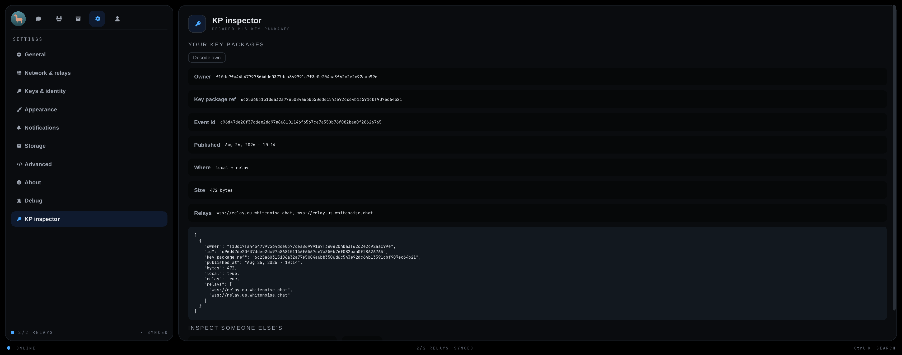
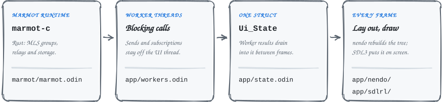

<!-- prettier-ignore -->
<div align="center">

<sub>DESKTOP CLIENT&ensp;·&ensp;MARMOT PROTOCOL&ensp;·&ensp;MLS OVER NOSTR</sub>

# White Noise Linux

### Group chat that relays deliver and can't read.

[](https://github.com/marmot-protocol/whitenoise-linux/actions/workflows/ci.yml)
[](LICENSE)
[](#install)
[](https://odin-lang.org)

[Install](#install) • [What's inside](#whats-inside) • [Security](#one-vault-seven-helpers) • [Build](#build-it-yourself) • [Docs](#further-reading)



</div>

White Noise Linux is a desktop client for [Marmot](https://github.com/marmot-protocol/mdk), which runs [MLS](https://messaginglayersecurity.rocks/) group encryption over [Nostr](https://nostr.com) relays. Your identity is a Nostr key you hold, not a phone number, and no server owns your account.

It is one Odin binary with its own layout engine, nendo, drawing through SDL3.

> [!NOTE]
> Early software: usable every day, moving fast, rough edges included.

## Who sees what on the way

<picture>
  <source media="(max-width: 600px) and (prefers-color-scheme: dark)" srcset="assets/readme/trip-narrow-dark.svg">
  <source media="(max-width: 600px)" srcset="assets/readme/trip-narrow-light.svg">
  <source media="(prefers-color-scheme: dark)" srcset="assets/readme/trip-dark.svg">
  
</picture>

## What's inside

- **Chats cover the basics, plus math.** Replies, reactions, edits with history, polls, forwarding, Markdown with typeset `$` math blocks, and Ctrl+K search over local history.
- **Attachments open in place.** Albums, video, voice notes, PDFs, archives, source code, and STL, OBJ, FBX, GLB or G-code models you can orbit.
- **A `.nes` attachment gets a Play button.** The cartridge runs in a modal: arrows move, X is A, Z is B.
- **Speech and translation stay on your machine.** Transcription and translation run locally; translation fetches about 2.5 GB of model files the first time.
- **Several accounts run at once.** Local nsec keys sit beside NIP-46 remote signers, and an offline queue sends what you wrote once you reconnect.
- **35 themes and 5 languages switch at runtime.** Pick from Chalkboard to Film Noir or drop in your own `themes/*.toml` pack; read in English, Italian, German, Japanese or Korean.

Narrow windows switch to a one-view phone layout for mobile Linux. The [feature tour](docs/features.md) covers the rest, from folder rules to Jitsi call cards.

## Install

Every release on the [Releases](https://github.com/marmot-protocol/whitenoise-linux/releases) page ships these builds:

| Platform | Download |
| --- | --- |
| Linux x86-64 | AppImage, Flatpak bundle, or `whitenoise-linux-bin` from the AUR |
| Linux ARM64 and x86-64 | Tarball; needs glibc 2.39 or newer |
| Windows 10 or newer | Installer or portable zip |
| macOS 13 or newer | `White Noise.app` for Intel and Apple silicon |
| OpenBSD 7.9 | Tarball, installed as root and run as your user |

The AppImage carries its own libraries, fonts and emoji:

```sh
chmod +x WhiteNoise-*-x86_64.AppImage
./WhiteNoise-*-x86_64.AppImage
```

On Arch, `yay -S whitenoise-linux-bin` installs the prebuilt package. First launch asks for a vault password, then lets you create a Nostr identity or bring one.

The [install guide](docs/install.md) covers Flatpak updates through Orchard, the self-updaters, the macOS first-launch prompt and OpenBSD.

## One vault, seven helpers

<picture>
  <source media="(max-width: 600px) and (prefers-color-scheme: dark)" srcset="assets/readme/safety-narrow-dark.svg">
  <source media="(max-width: 600px)" srcset="assets/readme/safety-narrow-light.svg">
  <source media="(prefers-color-scheme: dark)" srcset="assets/readme/safety-dark.svg">
  
</picture>

> [!CAUTION]
> There is no password recovery. Forget the vault password and everything sealed under it is gone. Export your account key separately; backups leave it out.

The [security model](docs/security.md) has the password policy, image limits and each helper's budget.

## Build it yourself

You need `just`, the [Odin dev-2026-10](https://github.com/odin-lang/Odin/releases/tag/dev-2026-10) release binary, a C and C++ compiler, CMake, Rust, SDL 3.4 or newer and a handful of media libraries. [Building from source](docs/building.md) lists the Debian and Arch packages, and the Nix flake that supplies all of them.

```sh
git clone https://relay.ngit.dev/npub1ven4zk8xxw873876gx8y9g9l9fazkye9qnwnglcptgvfwxmygscqsxddfh/darkmatter-linux.git
cd darkmatter-linux
just build
just run
```

The first build compiles the pinned Marmot runtime in Rust and is the slow one. After that, `just dev` recompiles only the Odin app and swaps the new code into the open window, vault still unlocked.

## From relay to pixel in four layers

<picture>
  <source media="(max-width: 600px) and (prefers-color-scheme: dark)" srcset="assets/readme/frame-narrow-dark.svg">
  <source media="(max-width: 600px)" srcset="assets/readme/frame-narrow-light.svg">
  <source media="(prefers-color-scheme: dark)" srcset="assets/readme/frame-dark.svg">
  
</picture>

Panes are plain procs that read `Ui_State`: no widget objects, no retained view tree. [`AGENTS.md`](AGENTS.md) has the conventions, and [development](docs/development.md) has the tests, reload rules and build caches.

```sh
just test          # build, then run the same checks as CI
just dev           # rebuild and reload in-process, keeping the window
just translations  # regenerate the gettext catalogs
```

## Contributing

Issues and patches go to [Committish](https://committish.app/r/naddr1qvzqqqrhnypzqen829vwvvu0az0a5svwg2st72n69vfj2pxax3lszkscjudkg3psqyv8wumn8ghj7un9d3shjtnr093x2un8w4ujuenedyq3gamnwvaz7tmjv4kxz7fwdenkjapwv3jhvqqsv3shy6mdv968getj94kxjmn40qlzryl7), the primary forge over ngit; GitHub is a mirror. Run `scripts/install-hooks.sh` before your first commit; CI runs the same checks. A commit that closes an ngit issue carries one `fixes nevent1…` trailer per issue.

## Further reading

| Guide | What's in it |
| --- | --- |
| [Feature tour](docs/features.md) | Everything the app does, area by area |
| [Install](docs/install.md) | Packages, updates, first run |
| [Configuration](docs/configuration.md) | Data directory, SOCKS5 proxy, telemetry, `marmot://` links |
| [Security model](docs/security.md) | The vault, password checks, helper sandboxing |
| [Building from source](docs/building.md) | Nix, distro packages, cross builds, releases |
| [Whip](docs/whip.md) | Terminal projects inside Chats |
| [Development](docs/development.md) | Tests, hot reload, caches, MDK patches |
| [Stickers](docs/stickers.md) and [GIFs](docs/gifs.md) | The picker's two media tabs |
| [Dictation](docs/stt.md) and [Read aloud](docs/tts.md) | Local speech models, sizes, licenses |
| [Timing diagnostics](docs/timings.md) | Debug > Timings and what each stage measures |
| [Performance notes](docs/send-connections.md) | Send reuse, [outbound latency](docs/outbound-latency.md), [large groups](docs/large-group-performance.md) |

<sub>Licensed under [AGPL-3.0](LICENSE). The AI agent icons in Settings are [third-party marks](docs/features.md#third-party-marks).</sub>
