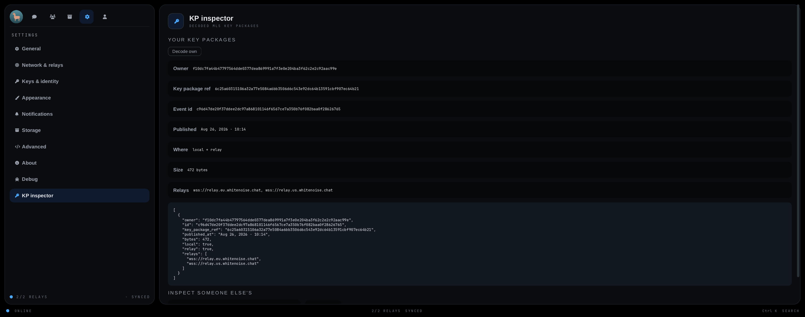

<p align="center">
  
</p>

<h1 align="center">White Noise Linux</h1>

<p align="center"><b>A native desktop client for end-to-end encrypted group chat over Nostr.</b></p>

<p align="center">
  <a href="https://github.com/marmot-protocol/whitenoise-linux/actions/workflows/ci.yml"></a>
  <a href="LICENSE"></a>
  
  
</p>

---

White Noise Linux is a desktop front end for [Marmot](https://github.com/marmot-protocol/mdk): [MLS](https://messaginglayersecurity.rocks/) group messaging carried over [Nostr](https://nostr.com) relays. You get the forward secrecy and post-compromise security of MLS together with a portable, self-owned Nostr identity: no phone number, no central server, no account anyone can take away from you. It is one Odin binary drawing an immediate-mode [clay](https://github.com/nicbarker/clay) layout on SDL3, and every secret lives in a single password-encrypted vault.

> **Status: early.** It works and is usable day-to-day, but it is moving fast, so expect rough edges.

**Jump to:** [Features](#features) · [Install](#install) · [Build from source](#build-from-source) · [Configuration](#configuration) · [Architecture](#architecture) · [Development](#development) · [Contributing](#contributing) · [License](#license)

## Features

**Messaging**

- One-to-one and group chats, end-to-end encrypted through Marmot's MLS, with sealed-sender invites over NIP-59.
- New chat opens a searchable contact picker. Choose a contact or select New group to set its name and photo. Groups require a first member: type to filter your contacts and select one, or paste a Nostr address.
- Group settings show name, description, photo, disappearing-message, and issue-tracking controls only to admins. Other members can view the group's name, description, photo, and current disappearing-message timer in full units, such as "90 days".
- Only group admins can promote, demote, or remove members. Nicknames change your local labels and remain available to other members.
- Markdown bodies (with typeset `$` math blocks), reactions, replies, edits with history, forwarding, and search.
- Linked Nostr highlights (kind 9802, NIP-84) put the selected passage in large type, with quieter context, avatar bylines, and compact source tiles. Cards start with the highlighter's byline, without a kind label. Source tiles identify the domain, event, or structured source. Source links and the full-width Open in client button use the external-link guard. Read more expands the quotation, context, and commentary together. Media-only highlights retain their source tiles.
- Markdown bodies preserve single newlines. HTTP(S) links keep their labels and destinations. Hover shows the URL; opening a link uses the external-link guard. Chat-list previews show reading text without Markdown markup.
- Pasted `https://njump.me/<reference>` and `http://njump.me/<reference>` links render like `nostr:` references: profile chips for `npub`/`nprofile`, event cards for `note`/`nevent`/`naddr`. Event cards use your configured Nostr web client.
- Linked Nostr pull requests (kind 1618) and Git issues (kind 1621, NIP-34) show their own icon and label, a bold subject when present, separate author and timestamp lines, and a Markdown description. Long subjects wrap to three lines with an ellipsis. A full-width Open in client button uses your configured Nostr web client.
- Linked Git patches (kind 1617, NIP-34) show the mail subject, author, repository, revision or series marker, and file/addition/deletion counts. The diff preserves code as literal monospace text, with tinted additions and deletions. Read more expands the description and diff; inline diffs stop at 1,000 wrapped rows, with the complete patch available through Open in client. Cover letters show their subject and description without invented change counts.
- Markdown timestamps such as `<t:1791280800:F>` display in your current timezone with a clock icon. Hover over a timestamp to see its absolute local date/time and original token. Styles `t`, `T`, `d`, `D`, `f`, `F`, `s`, `S`, and `R` cover time, date, combined, and live relative labels; omitting the style selects `f`. Absolute labels follow your Date format and Time format settings and the app language, like the rest of the app's dates. Invalid tokens stay literal, and unsupported dates remain readable tokens.
- Day dividers say Today for the current local day and update at midnight. The chat list shows the time for today, Yesterday, then the date. Changing the Date format, Time format or language updates every visible date at once, including the open chat.
- Search all chats takes start and end days in your local calendar, written the way the app shows dates (`Jun 12`, `12 Jun 2026` or `2026-06-12`); without a year, the current one is used. Results are dated the way the chat's day dividers are.
- Settings > Appearance sets the message line limit. Messages and event cards collapse after 6 lines by default; 0 shows them in full without Read more.
- Settings > AI agents offers setup prompts for Hermes, OpenClaw, OpenCode, Codex, and Claude Code. Review and copy a prompt containing your active account's public npub, then paste it into an agent you run and trust. Copy prompt is the main action, with a secondary Copy public key button and links to connector documentation. White Noise does not install anything or share your private key.
- Ctrl+K searches literal text in locally stored history, including archived chats. Filter by chat, sender, local date range, or attachment type, and use More results to page through matches. Opening a result returns to Chats and loads older history when needed. Closing search preserves its query and results; switching accounts clears them. Unsynced messages are not searched.
- Export the loaded chat window as HTML or Markdown from the members panel. HTML prepares embedded images in the background and shows image progress before opening the save dialog. Unavailable images appear as notes in the transcript. Leaving the chat or changing accounts discards an unfinished export.
- Emoji search accepts names and shortcodes, such as `100` for hundred points and `thumbsup` for thumbs up. Shortcodes work with or without surrounding colons.
- The emoji picker's eight most recent choices survive app restarts, newest first.
- Settings > General > Messaging > Custom emoji browses recent [NIP-51 kind-30030 emoji sets](https://github.com/nostr-protocol/nips/blob/master/51.md) from your event-fetch relays. Sets from your contacts come first, with A-Z ordering within each group and a saved Contacts only filter. Sets with no valid emoji stay hidden. Each row shows artwork and an author mention chip. Search by title, author, or shortcode, then open a set to preview it. Import the whole set or use the + button beside one emoji. Previews appear as each download finishes. Imported emoji keep their set title and verified author after a restart. Imports preserve existing shortcodes and report skipped entries and failed downloads. Browsing previews and importing contact HTTPS image hosts; PNG, JPEG, GIF, and WebP are supported when the image decoder accepts them.
- Custom `:shortcode:` emoji use NIP-30. The image goes out as an encrypted attachment, and the message carries an `["emoji", shortcode, url]` tag pointing at that attachment's Blossom URL. Reactions work the same way: a `:shortcode:` reaction carries its own `imeta` and emoji tag. Forwards keep the tags. MDK's `marmot_send_tagged_media` and `marmot_react_with_media` send them, and MDK keeps the media key for reaction images the way it does for chat media.
- A durable on-disk send queue, so messages written offline aren't lost and go out on reconnect.
- Forwarded attachments download and prepare in the background. A status strip names the destination and stays visible through preparation and sending, even if you switch chats. Failed forwards can be retried from the destination chat.
- Per-chat unread tracking, surfaced as rail badges.
- Deleting a chat folder requires confirmation, from both Settings and its context menu. Only the folder is removed; its chats stay in your chat list.
- Folder rules file chats automatically: name includes a word, has a member (npub), has fewer or more than N people (you included), or has unread messages. Each folder matches all of its rules or any one of them. A chat goes to the first folder, in folder order, whose rules match. A chat you move by hand stays in that folder; choosing "Follow folder rules" in the move dialog hands it back to the rules. Member rules read each group's member list on every chat-list refresh, and only while such a rule exists.
- Settings > Folders lists every chat under the folder it files into. Drag a chat onto a folder (Unfiled included) to keep it there, or drag a folder header to reorder folders. Chats placed by hand show a checked box; clearing it hands the chat back to the rules. In Recent mode, every folder appears beside Chats, Unread, Groups, and Whip as a filter, keeping recent activity order within the selected folder. In Grouped mode, empty folders stay out of the chat list sidebar.

**Media**

- Drag one or more files into the open chat to stage attachments. Files prepare in the background, with image thumbnails when available. Remove unwanted files with the × on each chip; press Enter when preparation finishes to send. Drops outside the conversation or over a modal do not attach files.
- [Personal stickers and Nostr packs](docs/stickers.md), with pack previews from received stickers.
- Image albums, inline video (libmpv), voice messages, and a preview modal that reads PDFs (poppler), archives (libarchive), STL, OBJ, FBX, and GLB models, and source files with syntax highlighting.
- Enable Speech to text in Settings to transcribe audio attachments locally. M4A files use the audio card and its Transcribe button, including attachments labeled `video/mp4` by another client.
- Direct JPG, PNG, GIF, and WebP links show inline cards with the image above its clickable URL. Link previews are on by default; turn them off in Settings > Advanced > Security & privacy to stop new automatic preview requests, including supported-site cards. Preview hosts can see your IP address. Attachment downloads are unaffected.
- Locations shared from the Android app (`Location: https://maps.google.com/maps?q=<lat>,<lon>`) show an OpenStreetMap card in place of the Google link. Pasted OpenStreetMap, Kagi Maps, Apple Maps, and Google Maps links that name a point or a map view get the same card, opened at the link's zoom: markers, place pages, search pages, and plain map views (for example `https://www.openstreetmap.org/?mlat=0&mlon=0#map=12/0/0`, `https://kagi.com/maps/#14.58/0/0`, or a Google `/maps/place/…/@lat,lon,17z` link). Google's country domains such as google.it are not recognized. Drag the map to pan, scroll or use the zoom buttons to zoom, and Recenter to return to the pin. The card names the town and country and offers Copy coordinates and an Open in link. Settings > Advanced > Open locations in picks the site that link opens: OpenStreetMap (the default), Apple Maps, Kagi Maps, or Google Maps. That site receives the location; the map on the card always comes from OpenStreetMap. Tiles come from tile.openstreetmap.org and place names from Nominatim, which receives the coordinates rounded to three decimals; the app never contacts Google on its own. The first card asks before loading anything; Settings > Advanced > Location maps changes the answer later, and turning off link previews hides the cards. Tiles are cached in the encrypted media cache under keyed file names, up to 1 GB with the oldest fetches removed first, and are fetched again after a week.
- To send a location, use the pin button beside the composer. Drag or zoom the map to choose a point, or choose Use current location to request permission through the Linux desktop's location portal. Review the pin, then choose Send location. Current location needs a desktop portal backend and location service; if unavailable or denied, pick a point manually. Sending keeps your composer draft and staged attachments and uses Android's location message format.
- Signal call links (`https://signal.link/call/#key=…`) and Jitsi Meet room links show a call card styled after that app, with a join button and a line saying the call runs outside White Noise. meet.jit.si rooms are recognized from the URL. For any other host, a one-segment room link (`https://meet.example.org/Standup`) prompts one request to `https://<host>/external_api.js`, the script every Jitsi Meet server publishes; hosts that serve it get the card, and the answer is kept until the app restarts. Clicking goes through the external-link guard like any other link. If Signal Desktop or the Jitsi Meet desktop app is registered for `sgnl://` or `jitsi-meet://`, the call opens there directly; otherwise it opens in your browser. Turning off link previews shows plain URLs and stops the Jitsi host requests.
- PDFs have fullscreen controls on attachment tiles and in previews. The fullscreen modal fills the app window without changing desktop fullscreen. Pages fit the window and render at its pixel density, with previous/next controls. Exit fullscreen returns to the preview; Escape closes it.
- Attachments travel over Marmot's encrypted MIP-04 path. Profile pictures are the one deliberate exception: they go out publicly via Blossom.
- GLB attachments open as static 3D scenes with orbit, zoom, and the model inspector. The viewer reads node transforms, material factors, and embedded PNG/JPEG textures on UV0. GLB animation, skinning, morph targets, vertex colors, and Draco/meshopt compression are not supported. External resources are never fetched; translucent materials use alpha cutouts.

**Games**

- A `.nes` attachment, or an archive holding nothing but one `.nes` file, shows a cartridge tile with a Play button. The game runs in a modal: arrow keys move, X is A, Z is B, Enter is Start, Shift is Select, and Escape closes it. Supported boards are mappers 0, 1, 2, 3, 4 and 7 (NROM, MMC1, UxROM, CNROM, MMC3, AxROM). There are no battery saves, save states or gamepad input.

**Identity & accounts**

- Several accounts at once, with local nsec keys and NIP-46 remote signers side by side. Connected accounts receive messages in the background.
- The app opens on the account you used last. For a remote-signer account it starts on a local one and switches once the signer connects.
- The trash button on an account row (the Accounts switcher or the Profile page) removes that account from this device after you confirm. Its keys and local chats are deleted; its groups are not notified, so other members still see it.
- Connect with a `bunker://` link or scan/copy a `nostrconnect://` pairing link. Approve requests in your signer; pending operations show their status and approval links.
- Contacts, private local-only per-contact nicknames, an archive, and npub QR codes.
- Your profile is public. The optional Verified address field holds a Nostr identifier (NIP-05), not your email address.
- Profiles without a loaded name show a deterministic adjective and animal, such as "Magnetic Panda", derived from their public key. Published names replace it when loaded; local nicknames take precedence. The npub remains visible on profile cards.
- Import and export contacts as CSV or JSON from the contacts rail. Imports skip existing contacts and duplicate npubs, restore private nicknames and blocked state, and report added, skipped, and failed records. Published profile names still come from Nostr.

**Look & feel**

- Thirty-three bundled themes and five accent colors, all data-driven from `themes/*.toml`. Each pack defines its accent labels with `accent-name-1` through `accent-name-5`, matching the order of `accent-base`. The theme editor preserves these labels. Drop your own pack in the data dir.
- AMOLED uses black and white theme colors and hides its accent chooser. A whole-view pass reduces color saturation to 25%, including avatars, emoji, and media.
- Film Noir adds visible, moving film grain to the whole view, including photos and video. Reduce motion freezes the grain; the filter adds no contrast or vignette.
- Settings > Appearance > Center the conversation centers the message timeline and composer in a column at most 720px wide. Settings search accepts both "center" and "centre". Narrower windows use the available width; turning it off restores full width.
- Settings > Appearance puts controls, the theme gallery, and a live conversation preview side by side on wide windows. Medium windows put controls beside stacked themes and preview; all three panels scroll independently. Narrow windows stack them on one page. The preview uses the normal chat renderer with a fictional marmot conversation, not your messages or draft.
- The theme gallery has separate Dark and Light views and collection headings. Hover over a tile to preview it. Leaving the tile or pressing Escape restores your theme; clicking saves the choice.
- The Sidecar collection contains all 21 themes from [dmnyc's Sidecar](https://github.com/dmnyc/sidecar). Selecting one shows its source credit on the page and the selected tile. Collection headings have no links.
- Royale and Royale Dark use XP Royale's blue chrome with pearl or charcoal surfaces and bevelled controls.
- Chalkboard and Crayon use bundled Kalam lettering at 125%, textured surfaces, fixed rough strokes, and sketched avatars. The Hand-drawn filter toggle in Appearance turns the material effect off without changing the palette or lettering size. This filter preference is shared by both themes.
- Chalkboard erases the photo to reveal its identity fingerprint on avatar hover, then redraws the photo when the pointer leaves. Other themes keep the swivel reveal.
- Terminal uses a fixed green accent and hides its accent chooser.
- Button text derives separately for each accent color using sRGB contrast. Custom packs can set `on-accent` to override the text color for all five accents.
- English, Italian, German, and Japanese, switchable at runtime, including search dialogs, theme notifications, and confirmation errors.
- Native desktop notifications, a command palette, and full keyboard navigation.
- Chat transitions follow the conversation, not its position in the list. New messages can reorder the list without sliding the open chat.
- Reduce motion hides animated synth, dust, scan, and wave backdrops, including the vault gate's synth backdrop. Static decorations remain visible.

**Privacy & data**

- One password-encrypted vault holds every secret (see [Security model](#security-model)).
- Lock now in the status bar or command palette closes the runtime, clears the vault key and session state, and returns to the password gate without closing the window. Unlock with your vault password to reconnect.
- Encrypted backup and restore for settings, drafts, custom emoji, and themes. Account keys and message history are not included.
- Opt-in OTLP metrics and audit logging, both off until you turn them on in Settings.

## Security model

There is no OS keyring and no plaintext key on disk. Every secret (your nsec, Marmot's per-account MLS keys, the decrypted media cache, the offline queue) lives in a single vault file (`vault.db`) sealed with XChaCha20-Poly1305 under a key derived from your password with Argon2id.

For NIP-46 accounts, your Nostr private key stays in the remote signer and cannot
be revealed or exported here. Client communication keys and device-local database
keys stay in your encrypted vault. Locking or restarting disconnects the transport
without logging out. Signing out removes the saved session and attempts remote
logout even if the signer is unavailable. Each account reconnects independently;
an unavailable signer does not block local accounts.

The flip side is that **there is no recovery**: lose the password and the data is gone. Export your account key separately; local-data backups do not include account keys or message history.

Creating or changing a vault password requires at least 40 bits of estimated
strength. The Odin check counts character diversity and discounts repeated
blocks and alphabet or keyboard sequences. It rejects whole passwords found
in the [SecLists common-password file](https://github.com/danielmiessler/SecLists/blob/master/Passwords/Common-Credentials/10k-most-common.txt),
including case changes and simple letter substitutions. It does not penalize
individual words inside a passphrase or require particular character classes.
Use unrelated words or a password-manager password.

The corpus is staged at `vendor/common-passwords.txt`, pinned by
`seclists-passwords-file` in `DEPS_PIN`, and embedded in the app. The check
runs offline.

This heuristic does not measure entropy, model a full dictionary attack, or
predict cracking time. It scores the first 100 Unicode characters to bound
its work; the full password encrypts the vault. Existing passwords still unlock
regardless of strength. The `WN_VAULT_PW` harness bypasses this UI policy.

Image previews stay in memory for the session. They check decoded format
and dimensions, with a 16 MiB download limit and a 16-megapixel decode limit.
These checks do not sandbox image decoders or prevent requests to
private-network hosts. Disable link previews if you do not want message
links fetched automatically.

## Install

Every tagged release publishes a self-contained x86-64 AppImage on the [Releases](https://github.com/marmot-protocol/whitenoise-linux/releases) page. It carries its own libraries, fonts, and emoji set, so there is nothing to install alongside it:

```sh
chmod +x WhiteNoise-*-x86_64.AppImage
./WhiteNoise-*-x86_64.AppImage
```

Japanese text is the one exception: Noto Sans CJK is tens of megabytes, so it is not bundled and comes from your system instead (`noto-fonts-cjk` on Arch, `fonts-noto-cjk` on Debian and Ubuntu).

For Flatpak updates, install [Orchard](https://github.com/Letdown2491/orchard)
0.3 or newer and find White Noise in its Orchard catalog. Check the publisher
against `orchard.txt` in this repository, then choose Verify and install.
Orchard verifies the signed release and each OCI component before installation;
subsequent updates are managed by Orchard, outside White Noise's sandbox.
The package uses the GNOME 50 runtime and currently supports x86-64.

Each release also ships a standalone Flatpak bundle for manual installation.
This download does not set up an update remote:

```sh
flatpak install --user WhiteNoise-*-x86_64.flatpak
flatpak run dev.ipf.whitenoise
```

The Flatpak keeps its data under `~/.var/app/dev.ipf.whitenoise/`. One thing stays outside its sandbox: "Launch at login".

Linux ARM64 and x86-64 tarballs and Windows x86-64 packages are built on
Linux alongside the AppImage and Flatpak; macOS Intel and ARM64 bundles are
built on a Mac, and the OpenBSD package on OpenBSD 7.9.

| Target | Archive | Launch |
| --- | --- | --- |
| Linux ARM64 / x86-64 | `WhiteNoise-<version>-linux-{arm64,amd64}.tar.gz` | Extract and run the top-level `whitenoise` script; requires glibc 2.39 or newer |
| Windows x86-64 | `WhiteNoise-win-Setup.exe` or `WhiteNoise-win-Portable.zip` | Run the installer, or extract the portable zip anywhere and run `White Noise.exe`; requires Windows 10 or newer |
| macOS Intel / ARM64 | `WhiteNoise-<version>-darwin-{amd64,arm64}.tar.gz` | Extract `White Noise.app`; requires macOS 13 or newer |
| OpenBSD amd64 | `WhiteNoise-<version>-openbsd-amd64.tar.gz` | Install as root under a protected prefix, then run as your normal user (see below). Requires OpenBSD 7.9 and `pkg_add libarchive libwebp mpv poppler cairo curl glib2 zenity libnotify`. Reading aloud and dictation are not included |

Windows installs update themselves through [Velopack](https://velopack.io).
The app checks this repository's GitHub releases at launch and every six
hours, downloads a newer build in the background, and shows a
"Restart now" strip in the status bar. An update left waiting applies on the
next launch. The About page in Settings shows the update state and has a "Check now"
button. The portable zip updates the same way, in place. A build run from
anywhere else (a development build, a staging zip) has no updater and shows
no update UI.

AppImage builds use [AppImageUpdate](https://github.com/AppImageCommunity/AppImageUpdate)
for signed delta updates. In Settings, About, choose "Check now" to check and
download, or enable "Automatically download updates" to check at launch and
every six hours. Automatic downloads are off until you enable them. Downloads
show progress without blocking chat. "Restart now" saves your drafts and
relaunches the updated AppImage with the same data directory. "Later" leaves
the current version running; a normal quit installs the download for your next
launch. The updater preserves the original filename and
keeps the previous image for rollback. Updates must carry a valid signature
from the installed image's signing key and a newer version, including the
same-day revision. The AppImage must be in a writable, privately controlled directory.

macOS builds use [Sparkle](https://sparkle-project.org) for update checks,
download progress, and installation. Settings, About has "Check now" and an
automatic-checking preference. Sparkle asks for permission to check
automatically and verifies the update archive's Ed25519 signature before
extraction. Installing an update saves your drafts before quitting and
preserves your data directory on relaunch.

AppImage and macOS update checks are disabled while a SOCKS5 proxy is
configured, because their update frameworks cannot use the app's proxy
settings safely. Download a release manually instead. Flatpak, AUR, other
tarballs, and development builds do not use these self-updaters. Existing
AppImage and macOS versions without an updater need one manual upgrade to
an updater-capable release.

Windows and macOS builds do not run webxdc (`.xdc`) apps. Linux retains its
WebKitGTK webxdc viewer. Ordinary attachments, video, PDFs, 3D previews,
speech and dictation are not disabled on the other targets.

The macOS bundle is ad-hoc signed, not Developer ID signed or notarized, so
macOS says it cannot verify the developer the first time you open it. Open it
once with Control-click, Open (or System Settings, Privacy & Security, Open
Anyway); after that it launches normally. A Developer ID signature and
notarization need an Apple Developer account.

On Arch, install `whitenoise-linux-bin` from the AUR. It installs the
`WhiteNoise-<version>-archlinux-x86_64.tar.zst` each release ships, which CI
builds on Arch against the system SDL3, mpv and poppler, so installing
compiles nothing:

```sh
yay -S whitenoise-linux-bin
```

`whitenoise-linux` builds the latest release from source. Every input it
needs is a checksummed source in its PKGBUILD, generated from `DEPS_PIN` by
`scripts/aur-source.sh`, and `build()` runs with the network off. Expect a
long first build: it compiles the Rust Marmot library.

```sh
yay -S whitenoise-linux
```

`whitenoise-linux-git` builds the current master from source. Its
`prepare()` downloads every pinned input and `build()` runs with the network
off. To build it from a checkout:

```sh
cd packaging/arch/whitenoise-linux-git && makepkg -si
```

The three packages conflict with each other and with `whitenoise-git`, the
Flutter client, because all of them install `/usr/bin/whitenoise`.

### Versioning

`APP_VERSION` in `app/advanced.odin` is `YYYY.M.D+REVISION`, starting at
`2026.9.15+1`. Like Android and iOS, the date is the release date and the
numeric revision increases for every shipment, including on a new date.
Set it before releasing and tag that commit `vYYYY.M.D-build.REVISION`
(for example, `v2026.9.15-build.1`). Never reuse a published tag.
About, diagnostics, AppImage, Flatpak, and Arch packaging use this version.

## Build from source

### Nix (x86-64 Linux)

The repository's flake supplies the native build tools and libraries in an FHS
environment; it does not require a global `nix-ld` setup. From this checkout,
enter the interactive shell and use the existing build commands:

```sh
nix --extra-experimental-features 'nix-command flakes' develop
just build
just run
```

For a single command, use the app entrypoint instead of `nix develop -c`, because
the FHS shell hook consumes command arguments:

```sh
nix --extra-experimental-features 'nix-command flakes' run . -- odin version
```

The lock pins Odin and OLS to dev-2026-10, while CI uses Odin dev-2026-09.
Rust is pinned to 1.97.1; install that toolchain with `rustup` if it is not
already available. Cargo output defaults to `target/nix` in the working
directory unless `CARGO_TARGET_DIR` is set.

Running the GUI still needs the host desktop session, display/audio sockets,
and GPU devices. The shell preserves access to host desktop resources,
including Omarchy Compose data when present. It uses the host driver set on
NixOS and Nix Mesa elsewhere. The first build still downloads the project's
pinned source dependencies and resource bundles described below.

### System packages

You need `just`, the [Odin compiler](https://odin-lang.org/docs/install/), a C and C++ compiler, CMake, and a Rust toolchain (Marmot's C bundle is built from source). Plus SDL 3.4 or newer and the media libraries the viewers bind. Flatpak bundles SDL because the GNOME 50 SDK ships SDL 3.2.

**Debian / Ubuntu** (SDL3 needs 25.04 or newer, or a source build):

```sh
sudo apt-get install -y just pkg-config cmake clang git curl \
  libsdl3-dev libarchive-dev libmpv-dev libpoppler-glib-dev libcairo2-dev libglib2.0-dev \
  libcurl4-openssl-dev libssl-dev libfreetype-dev libwebp-dev \
  libavformat-dev libavcodec-dev libavutil-dev libswresample-dev zstd
```

**Arch:**

```sh
sudo pacman -S --needed just odin rust cmake sdl3 libarchive mpv ffmpeg poppler-glib cairo glib2 curl openssl freetype2 libwebp zstd
```

**Then:**

```sh
git clone https://github.com/marmot-protocol/whitenoise-linux
cd whitenoise-linux
just build
just run
```

The first build clones the pinned Marmot revision and builds its C bundle,
fetches Clay, ufbx and Bragi, and extracts the SHA-256-pinned emoji bundle
with `zstd`. It also builds Odin's STB archives when the installation lacks
them. Later builds reuse the staged dependencies.

The native Linux build extracts speech, font, and emoji archives without
restoring ownership, so it can run as root inside Flatpak's restricted user
namespace.

Native Linux builds, Linux tarballs, and app test binaries hide the symbols
in `libmarmot_c.a` from shared libraries. This keeps Marmot's bundled OpenSSL
separate from libcurl's shared TLS libraries during certificate verification.

The emoji bundle contains each set's PNGs, catalog, licenses and
`emoji/<set>.bin` pixel pack. Cold font and emoji staging measured
0.86-1.62 seconds on a Ryzen AI MAX+ 395 across three fresh-output runs,
including archive verification and extraction, but excluding downloads and
without flushing filesystem caches. The bundle download is about 85 MB;
its independently compressed sets are extracted concurrently.

Maintainers regenerate the bundle with `bash scripts/emoji-bundle.sh`,
using librsvg 2.62.3, cairo 1.18.4 and Odin's STB headers. The script uses
the upstream pins in `DEPS_PIN` and fixed archive metadata. Upload its
output to the `deps` release, then update `emoji-bundle-file` with the
printed SHA-256 and download URL. Normal builds need no SVG renderer or
host emoji-packer compilation.

The app reads the active set's fixed-size RGBA data at startup (and again
when you pick another set in Appearance) and uploads only visible picker
rows, so opening, scrolling, and searching do not launch PNG decoders for
catalog emoji. Each pack is about 119 MiB uncompressed (OpenMoji's 153 MiB,
with its own extra emoji), so the three add about 391 MiB of resources;
only the active one is resident. They ship beside `emoji-catalog.tsv` in
every package.

The release workflow also builds Flatpak on `master` to populate caches that
later tags can restore. It caches the GNOME 50 module outputs, downloads,
Git mirrors, and ccache, plus separate Marmot and C dependency outputs.
Marmot requires an exact pin-and-patch match; ufbx uses the same build stamp
as native CI. Bragi compiles with the Odin math helper. Cargo target directories are not cached, and
Flatpak objects are kept separate from native Ubuntu objects. Only tag
builds publish releases.

### Whip inside White Noise

On Linux, native builds detect an executable `../whip/build/whip` and its
built Ghostty library. Build Whip first, then rebuild White Noise. While that
executable is installed, its projects appear inside Chats with a terminal
icon, directory, tab count and selected accent. White Noise attaches to Whip's
`default` session, starting its server if needed.

Chats and terminals share pinned-first, recent-activity ordering, search,
Unread and keyboard cycling. The Whip filter shows only terminals. Right-click
a terminal to pin it or move it to a folder. Grouped view and the Folders board
use the same assignments; an Is Whip folder rule files projects automatically.
Terminal recency follows your input and newly created projects, tabs and panes.
Opening a terminal does not move it up the list. Background output and
notifications do not change its recency either. Equal timestamps use stable
project IDs, so catalog refreshes do not shuffle tied rows. Recency is saved by
folder; activity while White Noise is detached has no timestamp available from
Whip.

Choose New terminal from the New chat chooser to pick a project folder and
open it. White Noise owns the tab strip, pane headers and draggable splitters.
Each pane has its own Whip rendering context inside its assigned slot. Tab
titles follow standalone Whip's naming rules, including live terminal titles
and emoji. Tabs and panes can be opened and closed from their native controls.
Project identity, tabs and the new-tab button share one compact header, using
the same styling as chats. Hover the project name for its full folder path.
Focus borders identify the active terminal. Split and docked titlebars are
hidden until you hover their top edge. Their names and controls overlay
the terminal without resizing it. Floating titlebars stay visible.
Keyboard tab changes and window resizing keep the active tab in view. The
ordinary mouse wheel browses the tab strip horizontally without changing tabs.

Appearance zoom scales terminal text along with the rest of the interface.
Fonts are rerasterized at the host's pixel scale rather than stretching an old
image. Configured terminal fonts and per-pane font-size shortcuts still apply.

One observer connection carries session snapshots and terminal output. Pane
contexts reuse those terminals instead of attaching another full-session
history stream. Snapshots decode in the background, with at most two decoders
at once. Subsequent output and resize events apply after that snapshot is restored.

Unchanged clicks reuse the terminal's cached frame. Focus changes repaint the
affected panes without invalidating unrelated terminals or reloading fonts.
Whip configuration refreshes when the host window regains focus. Opening
several panes initializes one native context per frame; font refreshes share
that budget. The focused pane initializes first. Hidden panes refresh when
shown. Pending panes keep
their opening progress visible until ready. Loading feedback stays in overlays,
including while tabs or splits are pending, so progress indicators do not
change terminal geometry.

Choose Float in a pane header to keep that shell above chats as you navigate.
Drag the header to move it; use the corner grip to resize it. Dock to chat
attaches it to the current conversation, beside the chat on wide windows or
below it on narrow ones. That pane appears only with its chat and account.
Drag the divider to give the chat or terminal more room. Side-by-side widths
and stacked heights are remembered separately.
Choose Float to detach it again, or Return to project to restore its original
slot and open its tab with shell input focused, without restarting it.
Selected tabs, floating positions and chat docks survive closing White Noise
and are scoped to your account. Saved panes reconnect only to the same running
Whip server, so a reused pane number cannot attach a different shell to a chat.
The startup restore setting also reopens your last selected terminal. Typing
or navigating while the catalog loads takes precedence over that restoration,
and restoring a terminal does not advance its recent-activity position.

Whip's keyboard shortcuts work while its content has focus. Ctrl+T and Ctrl+W
open and close tabs; Ctrl+Shift+Left/Right switches tabs. Ctrl+N creates a
project in the focused pane's directory. Ctrl+Alt+V and Ctrl+Alt+Minus split
panes. Pane focus, zoom, resize,
find, clipboard and rename shortcuts keep Whip's bindings. Ctrl+Alt+/ opens
Whip's shortcut help; Ctrl+Alt+Q returns to the inbox without stopping shells.
Ctrl+Shift+Up/Down moves between all visible chats and terminals, whether you
start in a chat or a terminal. It follows the sidebar's pin and folder order,
respects filters, skips collapsed folders, and wraps at either end. Ctrl+Tab
and Ctrl+Shift+Tab use the same order. Keyboard navigation scrolls the selected
row into view without taking over later wheel scrolling. Navigation and typing
queued together are processed in order, so text reaches the destination chat or
terminal. On a first visit, terminal keystrokes wait for that pane's native
input context instead of disappearing during initialization. Sidebar search
keeps the terminal visible while directing text input to the search field.

Returning to a conversation restores the message and position you were reading
in its main timeline, including after working in Whip. Reading positions are
kept per account and conversation for the current unlocked session. A chat left
at the newest message still follows the newest messages. Search results, reply
jumps and Jump to latest take precedence over the saved reading position.

Every project starts with a crop-circle avatar derived from its folder.
Click the avatar to choose and crop a picture, or restore its crop circle.
The choice is saved by folder, so renaming or recreating the project keeps
its picture. Pictures are copied into the config directory's `whip-avatars/`
folder; the original image file is not needed afterward.

Bells and terminal notifications from unseen panes show the same animated
unread badges as chats, on their tab, project and Chats navigation button.
Viewing a pane clears its waiting state; a pane hidden by zoom stays unread.
Desktop alerts use your White Noise notification, sound and preview settings.
On narrow windows, Back returns to the shared inbox. Switching pages or closing
White Noise leaves the session's shells running.

Whip is optional. Builds without that sibling checkout and cross releases
omit the integration. Native build scripts stage its Odin bridge from
`whip-embed/`; they do not build or modify the sibling checkout. An isolated
source copy under `build/whip-embed/` applies the host-notice and host-control
patches so navigation uses White Noise controls and terminal notifications
follow its settings without duplicate Whip alerts. The host-render patch
preserves cached terminal frames across unchanged input and metadata updates.
The host-source patch shares terminal streams and keeps snapshot decoding off
the UI thread without changing the installed server or Ghostty ABI. The
host-scale patch defers font reloads to their owning GL context and follows
White Noise zoom without multiplying display density twice.

### Cross releases

`scripts/cross-build.sh TARGET` accepts `linux-arm64`, `linux-amd64`,
`windows-amd64`, `darwin-amd64`, or `darwin-arm64`. `linux-amd64` is not a
cross build, but the same portable tarball recipe as `linux-arm64`.
`WN_TARGET=TARGET scripts/build.sh` invokes
the same path. The normal `scripts/build.sh` remains a native Linux build.
Each target has separate objects, Rust output, libraries and package files
under `build/cross/TARGET`; finished archives go to `dist/`.
Both native and cross builds include the Nostr and Namecoin WebSocket
transports (`ws_shim.c` and `nc_shim.c`) in `libwnws.a`.

The supplied amd64 Linux container includes the cross compilers and package
tools:

```sh
podman build -f packaging/cross/Containerfile -t whitenoise-cross packaging/cross
podman run --rm -v "$PWD:/work" whitenoise-cross linux-arm64    # or linux-amd64
podman run --rm -v "$PWD:/work" whitenoise-cross windows-amd64
```

The ARM64 build extracts an Ubuntu 24.04 target sysroot without running ARM
compilers. Windows uses LLVM-MinGW 20260922 with UCRT and libc++, paired with
Rust's `x86_64-pc-windows-gnullvm` target. Its separate vcpkg triplet avoids
reusing GCC/MSVCRT libraries. Windows 10 or newer supplies UCRT. Odin emits
target objects; the target C linker links the app with Marmot, Clay, STB,
the app shims and media libraries. Odin compiles Bragi's C API into the
`wn-math` object; the C++ linker links it with the Cairo drawing replay shim
(`libwnmath.a`) and Cairo. Source revisions are pinned in
`DEPS_PIN`, and Windows/macOS dependency recipes are pinned by the vcpkg
baseline in `packaging/cross/vcpkg.json`. FFmpeg includes dav1d for CPU AV1
decoding on Windows and macOS. Speech uses the same pinned upstream
sherpa-onnx CPU runtime as the native build. Packages include the speech/font
helpers, curl, their loader dependencies, fonts, emoji data and licenses.
The GUST font license is checked in at `assets/fonts/GUST-FONT-LICENSE.txt`
and staged locally by native and cross builds, without contacting CTAN mirrors.

macOS bundles build on a Mac, where Apple's SDK is licensed: Xcode or its
Command Line Tools supply it, and no Apple account is needed. An Apple silicon
Mac builds both architectures. `scripts/macos-setup.sh` installs the pinned
tools with Homebrew (GNU userland, bash 5, Odin, Bun, Meson) the way the
container does on Linux, and needs Homebrew, rustup and the Command Line
Tools already present:

```sh
scripts/macos-setup.sh ~/.cache/whitenoise-macos-tools
source ~/.cache/whitenoise-macos-tools/env
scripts/cross-build.sh darwin-arm64    # or darwin-amd64 for Intel
```

The build uses Xcode's clang with a pinned `-arch` and a macOS 13 deployment
target, then signs every Mach-O file and the bundle ad hoc with `codesign`.

OpenBSD builds natively on OpenBSD 7.9; there is no cross toolchain for it.
`scripts/openbsd-build.sh` lists the packages to install in its header, builds
the pinned Odin release from source (OpenBSD has no Odin package), runs
`scripts/build.sh`, and packs the install tree as
`dist/WhiteNoise-<version>-openbsd-amd64.tar.gz`:

```sh
doas pkg_add bash git cmake ninja gmake coreutils llvm%21 rust unzip-- \
  sdl3 libarchive libwebp mpv poppler cairo curl glib2 ffmpeg zenity libnotify zstd
bash scripts/openbsd-build.sh
```

Run the build as your normal user, with `sudo` or `doas` configured for
package staging. The script tests a root-owned installation, including an
Xvfb window that resizes and closes under confinement.

OpenBSD's Rust package (1.94) is older than the toolchain Marmot pins, so
`scripts/build.sh` enables the one unstable feature the build needs
(`cfg_select`) on OpenBSD. It also raises the per-process data size limit,
which rustc and Odin's optimizing build otherwise run out of.
Reading aloud and dictation are left out: sherpa-onnx publishes no OpenBSD
runtime, so those features report that they could not start.
Webxdc is disabled on OpenBSD. `.xdc` attachments remain ordinary downloadable
files; the build omits `wn-webview`, and installation removes an older copy.

OpenBSD requires a root-owned installation whose resources, helpers,
libraries and ancestor directories are not group- or other-writable.
Mutable symlink routes are rejected too. Extract the release as root into
a protected directory, not your home directory:

```sh
doas tar -xzf WhiteNoise-<version>-openbsd-amd64.tar.gz -C /usr/local
/usr/local/WhiteNoise-<version>-openbsd-amd64/bin/whitenoise
```

Run the app as your normal user. Running as root or directly from an
unprivileged build tree is rejected. For a source build, use
`doas bash scripts/install-tree.sh /usr/local/whitenoise whitenoise`, then
run `/usr/local/whitenoise/bin/whitenoise`.

The main process locks `unveil()` and enters `pledge()` after opening the
display, before starting attachment workers, the vault or Marmot. It keeps
networking, display/audio access and read-write access to the canonical
Marmot data, app settings and Downloads directories. Runtime resources are
read-only. Temporary files and caches stay under the data directory.
MDK anchors directory creation inside the unveiled data
tree; it does not require opening `/`.

SQLCipher's C build uses OpenBSD's concealed allocators instead of unsupported
`mlock` calls. Those allocations are excluded from core dumps and wiped on
free. They can enter swap; swap confidentiality depends on the host's
encryption policy. Marmot's bundled OpenSSL symbols are hidden from dynamic
libraries so they cannot replace system libcurl's incompatible LibreSSL symbols.

The main process has no `exec` promise. A prestarted broker launches only
the frozen `wn-*` helper paths, with fixed decoder arguments and an empty
decoder environment. A separate broker runs curl, notifications and file
dialogs with an inherited, locked policy. Display credentials are copied
into a private runtime home, removed with its GTK state on normal shutdown.
Forced termination can leave that private directory behind.

SDL is built from its pin without SysV shared memory and linked statically.
GTK dialogs use Cairo rather than GL for the same restriction. Links offer
Copy link, storage offers Copy path instead of Open folder, and Launch at
login is not offered. Network and desktop IPC remain available; this policy
does not isolate X11 or D-Bus from the rest of your desktop.

Websocket fetching remains in-process. Frame lengths are checked against the
remaining response capacity without adding untrusted lengths, including across
fragmented messages.

The `wn-font` helper receives an already-open input file on stdin, locks
`unveil()` with no paths and pledges `stdio` before initializing FreeType.

Still images are decoded by `wn-image`, including header probes for card,
sticker and model-texture budgets. The app sends compressed bytes over private
pipes and accepts only bounded RGBA pixels. Each request allows at most
128 MiB of input, 256 MiB of pixels and 32,768 pixels per dimension; individual
callers can impose smaller limits. The parent checks the response dimensions,
byte count, end of stream and exit status, and kills the helper after ten
seconds. A missing helper or failed decode has no in-process fallback.

Archives are listed and extracted by `wn-archive`. Requests accept up to
128 MiB of input, scan at most 65,536 headers and return at most 2,000 regular
files. Listings are limited to 8 MiB, with UTF-8 names up to 4,096 bytes;
one extracted entry is limited to 64 MiB. The parent validates every metadata
record before publishing it. Neither side writes extracted files to disk.
Links and libarchive filters requiring external programs are rejected.

PDF pages are rendered by `wn-pdf`. The app retains source bytes and requests
one page at a time, including on navigation and fullscreen resize. Input is
limited to 128 MiB and documents to 10,000 pages; each reply contains at most
64 MiB of RGBA pixels, with dimensions no larger than 32,768 or the requested
bounding box. Poppler and embedded-font parsing stay in the helper.

STL, OBJ, GLB and G-code parsing runs in `wn-mesh`; FBX parsing and animation
evaluation run in `wn-fbx`. Input is limited to 128 MiB, geometry to two
million triangles or toolpath segments, and flat replies to 512 MiB. The app
validates channel sizes, indices, finite values, strings and texture references
before publishing a model. Embedded GLB images go through `wn-image`.
Neither cgltf nor ufbx is linked into the main application.
FBX triangles are not subdivided after import; animation poses the imported
geometry without changing its topology.

G-code previews draw shaded, rounded toolpaths with depth testing and 2x
supersampling. The slider selects the printed portion; orbit and zoom change
the camera. Large previews show raster progress as toolpaths appear. Stroke
width is a visual approximation, not a measured nozzle or extrusion width.

Math blocks are rendered by `wn-math`, which compiles Bragi's Odin C API
alongside the helper and replays its drawing commands through a C++ Cairo
shim. The main application does not link Bragi. Each request accepts at most
4,096 source bytes and returns
at most 8 MiB of straight RGBA pixels, with dimensions no larger than 4,096.
The helper embeds Bragi's TeX Gyre DejaVu Math font. Invalid input, a failed helper or an exceeded
budget leaves the source text visible instead of rendering it in-process.

NES cartridges run in `wn-nes`, one helper per open game, over the same
sequenced exchange as `wn-fbx`. The app sends the ROM once (an iNES header and
at most 8 MiB), then one controller byte per emulated frame. Each reply holds
61,440 palette indices and at most 1,024 16-bit audio samples. A malformed
reply, a dead helper or a missed ten-second deadline closes the player.

On OpenBSD, `wn-image`, `wn-archive`, `wn-mesh`, `wn-fbx`, `wn-math` and `wn-nes` lock
`unveil()` with no filesystem paths and pledge `stdio` before reading input.
`wn-math` parses UTF-8 directly, without locale initialization or runtime font files.
`wn-pdf` initializes Fontconfig and the trusted bundled fonts first, then
unveils the bundle, standard system font trees and Poppler resource directories
read-only. Directory grants avoid OpenBSD's limit on individual unveiled names.
It locks that policy and pledges `stdio rpath` before reading PDF bytes.

The image, archive, PDF, mesh, FBX, math and NES helpers share a 1 GiB memory limit,
no inherited environment and only input, output and a null error stream.
On macOS, the address-space limit adds that budget to all startup mappings,
including Rosetta's reserved regions. Mach's basic task counter omits those
regions even though the kernel includes them when checking the limit.
Image, archive, PDF, mesh and math helpers
have five CPU seconds and ten seconds wall time; the parent requires exact
reply framing, end of stream and successful exit. FBX helpers have a ten-second
deadline and an echoed sequence number per exchange, but no cumulative CPU
quota, so valid looping animations do not expire.
Static FBX helpers close after loading; animated helpers close with the model.
An invalid pose leaves the last validated geometry intact and closes the helper.
`wn-nes` follows the same session rules and closes with the player.

Failure has no in-process fallback. Linux requires `close_range` (kernel 5.9
or newer); descriptor or sandbox setup failure stops decoding. Platforms other
than OpenBSD use separate resource-limited processes, not an equivalent
filesystem or syscall sandbox. Video parsing remains in the main process.

`.github/workflows/cross.yml` is called by CI and tagged releases. Its Linux
ARM64 and Windows jobs extract the shipped archive and require a headless
launch to produce a screenshot under QEMU or Wine. No compiler runs under
those emulators. The cross-architecture Linux smoke uses a temporary package
view with helper launchers that re-enter QEMU, including helpers launched with
an empty environment. It runs the shipped executables and libraries, with only
glibc supplied by the target sysroot. The macOS jobs build and launch both
bundles on Apple silicon, using Rosetta for the Intel bundle. Its
OpenBSD job boots the OpenBSD 7.9 image from
[cross-platform-actions](https://github.com/cross-platform-actions/action)
under QEMU, builds and packages inside it, and launches the packaged binary
headless there.

Platform-specific Odin code can be checked from Linux before building a package:

```sh
odin check app -target:windows_amd64 -define:WN_TARGET=windows-amd64
odin check app -target:openbsd_amd64 -vet-unused-imports
```

These commands type-check the app; they do not link it or verify runtime behavior.

The app shows the version written in `APP_VERSION` (`app/advanced.odin`); a
tag does not change it, and `release.yml` rejects a tag that does not match
it. `just release` (`scripts/release.sh`) keeps the two together: it takes
`origin/master` (a dirty checkout or another branch is left untouched), sets
`APP_VERSION` to today's date with the next revision (`2026.9.27+1`, then
`+2` the same day), commits that on top, tags `v2026.9.27-build.1`, and
pushes the result and the tag to both remotes. The tag reaching GitHub
starts the release build. `just release --dry-run` prints the version and
tag without changing anything.

`just publish` (`scripts/publish.sh`) does all of that, waits for the
release workflow to publish the GitHub release, then signs its AppImage,
Flatpak bundle, and Orchard OCI components with your bunker or nsec.
One NIP-82 release lists all five assets and is sent to
`wss://relay.cyberguy.fyi`, `wss://relay.orchard.rocks`,
`wss://relay.ditto.pub`, and `wss://relay.zapstore.dev`.
`just publish <tag>` waits for and announces an existing release without
creating another one. Use it to resume publication after the tag was pushed.
Both stores use the publisher in `zapstore.yaml`; `orchard.txt`
records that public key for Orchard's repository check.

Run `bash tests/release-test.sh` to check the release-to-publish tag handoff
with signed commits and local remotes, without publishing publicly.

The release publisher is the White Noise identity,
`npub1whtn0s68y3cs98zysa4nxrfzss5g5snhndv35tk5m2sudsr7ltms48r3ec`.
Run `just publish` (or `just publish <tag>` for a built release), paste its
`bunker://` URL at the hidden signer prompt, and approve the seven NIP-46
signing requests: one kind 32267 listing, five kind 3063 assets, and one
kind 30063 release. The publisher checks the returned signing key before
sending each event. The bunker URL stays out of command arguments and
shell history; exporting the White Noise private key is not required.

The Flatpak build prepares Orchard's manifest, config, layer, and bootstrap
OCI archive from the finished sandbox tree. These files and their checksums
are hosted on the GitHub release; a registry account and another signing key
are not needed. Preparation uses the Orchard revision in `DEPS_PIN` and
does not publish events. The signed announcement happens during
`just publish`, so a tag push alone does not add a version to Orchard.

Tagged releases publish the Windows installer, the portable zip, and
Velopack's feed (`releases.win.json`, `assets.win.json`, `RELEASES`, and the
`.nupkg` packages) to the GitHub release. The job first downloads the previous
release so Velopack can also publish a delta package. Windows packages are
unsigned unless `JSIGN_STORETYPE` is configured. Unsigned builds may trigger
Windows publisher and SmartScreen warnings. To enable Authenticode signing
with [jsign](https://ebourg.github.io/jsign/), set repository variables `JSIGN_STORETYPE` (jsign's
`--storetype`, for example `PKCS12` or `TRUSTEDSIGNING`) and `JSIGN_ALIAS`,
secret `JSIGN_STOREPASS`, and either secret `JSIGN_KEYSTORE_BASE64` (a
base64 keystore file, such as a `.p12`) or secret `JSIGN_KEYSTORE` (a cloud
keystore name or endpoint). Local builds sign when the same `JSIGN_*`
variables are passed to the container. Staging builds (a non-release version)
keep a plain zip and never join the update feed.

AppImage releases require the `WN_APPIMAGE_SIGNING_KEY` Actions secret, an
armored GPG private key matching `packaging/appimage-update-key.asc`.
`scripts/sign-appimage.sh` embeds that identity and the signature in the
image. Build its isolated updater with `scripts/build-appimage-updater.sh`
and stage with `WN_PACKAGE_APPIMAGE=1 scripts/install-tree.sh AppDir/usr whitenoise`.
Ordinary Linux builds compile only the small process bridge and do not build
or ship the delta updater.
The updater closes its GPG context before removing the temporary keyring,
including when an unsigned or invalid image is rejected.

macOS releases require `WN_SPARKLE_PRIVATE_KEY`, a base64 Ed25519 seed
matching `packaging/sparkle-public-key.txt`. Each architecture publishes its
own signed update archive and `appcast-<arch>.xml` on the GitHub release.
The public keys are committed; private keys stay in Actions secrets and
maintainer backups. Missing or mismatched release keys fail packaging.
Sparkle archive signatures authenticate updates independently of the
bundle's ad-hoc code signature; they do not add Developer ID signing or
notarization.

To store a generated key backup in KeePass, close that database in the GUI
and run:

```sh
scripts/store-release-keys.sh /path/to/passwords.kdbx /path/to/key-backup
```

The script uses the native or Flatpak KeePassXC CLI and prompts for the
database password. It creates `White Noise release signing keys` with the
AppImage private key, Sparkle seed and Sparkle PEM as attachments, then
reads each one back for comparison. Reruns verify existing attachments and
add missing ones, but stop if a stored key differs. Nothing is overwritten;
source keys are not deleted. Pass KeePassXC unlock options after the two
paths if needed, for example `-k /path/to/keyfile` or `--no-password`.

ngit staging uses `.ngit/act/workflows/release-cross.yml` alongside the
existing x86-64 AppImage workflow. The act worker needs Podman with working
user namespaces and permission to build and run nested containers. It has no
macOS job yet: those need a Mac act runner, and until one exists macOS
bundles come from the GitHub workflow. Each target is passed
to `actions/upload-artifact`; Blossom publication requires the coordinator's
`--blossom-servers` setting and an artifact-size limit large enough for the
archives (`--blossom-max-artifact-bytes`, commonly above the default 64 MiB).


### First run

On first launch, set a vault password, then import or generate an nsec, paste a
bunker link, or pair with a remote signer. Later launches unlock the same vault.
A wrong password cannot decrypt it. **Use another key** deletes the vault and
its sealed data and returns to account setup.

If relay discovery fails during key import or remote-signer login, missing lists
use `wss://relay.eu.whitenoise.chat`, `wss://relay.us.whitenoise.chat`,
`wss://relay.ditto.pub`, and `wss://relay.cyberguy.fyi`. Signed relay lists already
found remain unchanged.

## Configuration

The data directory is the app's first argument and defaults to `~/.local/share/whitenoise`. It holds the vault, the media cache, the offline queue, and any custom theme packs you drop in its `themes/` subdirectory. UI preferences (theme, accent, locale, notification toggles, nicknames) live separately in `$XDG_CONFIG_HOME/whitenoise/settings.json`.

The app restores your last page, settings section and tab, the rail's Unread
filter, and window size after a restart. Reopening Settings returns to the
section you left. These preferences are independent of General's
"Restore last chat" toggle, which controls only the selected conversation.

Set a SOCKS5 proxy under Settings > Network & relays > Relays. Enable the
proxy, enter a numeric address such as `127.0.0.1:9050` or `[::1]:9050`,
then choose Save and restart White Noise. Disable the switch, save, and
restart to return to direct connections. The setting is stored as
`prefs.socks5_proxy` in `settings.json`; an empty value disables it.
For authentication, enable Use username and password and fill both fields.
Each accepts 1 to 255 UTF-8 bytes. Credentials are stored in the encrypted
vault, not `settings.json`; `prefs.socks5_auth` stores only the authentication
choice. Leave that switch off for an unauthenticated proxy. Hostnames and
proxy URLs are not supported.
Before signing in, choose SOCKS5 proxy on the sign-in screen to configure
the same setting.

The proxy carries relay and remote-signer connections, media transfers,
link previews, embedded web pages, speech model downloads, and enabled
telemetry exports. Failed proxied requests do not fall back to direct
connections. Relay names are resolved through the proxy. Marmot's HTTP host
checks still use local DNS so downloads and telemetry retain their validated
address pins; this setting does not hide all DNS queries. QUIC agent previews
are unavailable while the proxy is enabled because they require UDP.
External browsers and other apps do not use this setting.

Telemetry and audit logs use built-in endpoints. To override them, create
`$XDG_CONFIG_HOME/whitenoise/observability.toml` (or
`~/.config/whitenoise/observability.toml` when `XDG_CONFIG_HOME` is unset).
Nothing is sent until you enable the corresponding toggles under
**Settings**, in the **Advanced** section.

A few environment variables matter, mostly for automation:

| Variable | Effect |
| --- | --- |
| `WN_VAULT_PW` | Unlocks (or creates) the vault without showing the gate. |
| `WN_SHOT` / `WN_SHOT_FRAME` | Capture a screenshot after N frames, then exit. |
| `WN_TEST_*` | Drive the app into a given pane or action on boot; see `app/main.odin`. |

### Deep links (`marmot://`)

Profile QR codes encode `marmot://profile/<npub>?from=qr`, the scheme shared by all Marmot clients. The app handles these when they arrive as a command-line argument or are pasted into **Add contact**. To have your desktop hand `marmot://` links to White Noise:

```sh
scripts/install-scheme.sh
```

## Architecture

```
 SDL3  ←──  app/sdlrl/  ←──  app/renderer.odin  ←──  clay layout (app/*.odin)
                                                          │
                                                    app/state.odin  (Ui_State)
                                                          │
                                              app/workers.odin  (worker threads)
                                                          │
                                                   marmot/marmot.odin
                                                          │
                                            marmot-c  →  the Marmot runtime
```

It reads flat by intent. The layout is immediate-mode: every frame rebuilds the clay tree by reading one `Ui_State` struct, so there is no retained view tree, no widget objects, and no observer graph to trace. Panes are plain procs.

| Path | What's there |
| --- | --- |
| `app/` | The whole app: panes, layout, state, workers, vault, media viewers |
| `app/state.odin` | `Ui_State`, the single struct every pane reads, plus the live theme globals |
| `app/chatpane.odin` | Chat-pane rendering, group info, and the composer |
| `app/loginpane.odin` | Sign-in and key-generation UI, with button and progress helpers |
| `app/workers.odin` | Live subscriptions, sends, member loading, and other blocking Marmot calls kept off the UI thread |
| `app/sdlrl/` | SDL3 shim with a raylib-shaped API: window, input, IME, clipboard, and a stb_truetype text engine |
| `app/vault.odin` | The password-encrypted secret vault |
| `marmot/` | The `marmot-c` bindings, the only place that touches C |
| `app/password.odin` | The allocation-free password-strength heuristic and input cache |
| `tests/smoke/` | Standalone liveness check for the bindings against a fresh home dir |
| `themes/` | The theme packs, `#load`ed at build time |
| `lang/` | gettext catalogs (`en` source, plus `it`, `de`, `ja`), `#load`ed at build time |
| `assets/` | Logo, fonts, and the SVG starter-avatar set |

A few design choices are worth knowing before you dig in:

- **Optimistic rendering.** Sending, reacting, and unreacting apply locally and repaint immediately, then reconcile against Marmot's response. The UI never blocks on the network round-trip.
- **Two upload paths.** Chat attachments go through Marmot's encrypted MIP-04 path, readable only by group members. Profile pictures take the deliberately public Blossom path.
- **Data-driven themes.** Every color, metric, and capability flag comes from a `themes/*.toml` pack. The parser and editor share one token-to-field table in `app/theme.odin`; `app/state.odin` owns the live colors. A new component reads the globals; it never branches on which theme is active. Fullscreen media uses `media-backdrop` and `media-chip-bg` for its backdrop and floating header.
- **Standard math.** Motion, decoration and sound synthesis call `core:math` directly, evaluating `f64` phases before narrowing to `f32`. Checkmark strokes use `math.sqrt` with a minimum normalization length of 0.001.

Sidecar palettes, title faces, and background artwork are pinned to
`3aaebf9dc7beb9924c6e1f9bc060cecbc1be6f8f`. Run
`bun scripts/render-sidecar-themes.ts` with Chromium installed to regenerate
the embedded 1280×800 background images from the source CSS and SVGs.
Backgrounds keep their aspect ratio and fill the window, centered with excess
cropped at the edges. Browser animations and component-surface gradients are
not reproduced. `font-title` selects a bundled display face
separately from the body `font`. Font licences, source hashes, and conversion
details are in `assets/fonts/sidecar/` and installed with the fonts. The native
text engine does not provide browser OpenType shaping.

For the deeper details, see [`AGENTS.md`](AGENTS.md).

## Development

```sh
just                   # list commands
just build             # build
just test              # build, then run the tests
just dev               # rebuild code in-process, keeping the window
just test-reload       # check reload, unlock, and failed-build recovery
just translations      # regenerate the gettext catalogs
```

`just dev [data-dir]` and `just run [data-dir]` accept an optional data directory.
The shell implementations live under `scripts/`; CI and packaging call them directly.

All tests live under `tests/`; `just test` runs the same checks as CI. For a focused Odin run, use `tests/odin.sh app [odin test flags]` or `tests/odin.sh app/sdlrl`. The runner assembles a temporary package so tests retain access to private symbols. End-to-end testing (a QEMU VM harness, a headless control daemon, and multi-VM messaging scenarios) lives in the separate [`darkmatter-automated-testing`](https://github.com/marmot-protocol/darkmatter-automated-testing) repo, which builds this checkout.

Vault fixtures must release `g_vault` with `vault_lock()` or `vault_delete()`
before releasing `test_home_lock`. The test allocator resets after each test;
leaving its strings in the vault lets a later worker free them with the wrong
allocator.

Theme and font registries outlive individual tests. Fixtures that populate
them use `runtime.default_context().allocator`. Tests that replace `g_ui` take
`clay_test_mutex` before `test_home_lock` when both are needed. Use nonfatal
expectations while holding these locks: Odin's `fail_now` skips deferred
unlocks and can stall the suite.

Mention-chip fixtures also populate the global profile caches. Use the runtime
allocator and defer `profile_session_clear()` while holding `clay_test_mutex`.

Composer wrapping allocates its cache on the process heap without changing
the caller's allocator. Mention measurement can queue profile reads; those
IDs must stay on the UI heap that frees completed batches.

Closed avatar covers stay in normal layout flow so sidebar mentions retain
both the preview's horizontal clip and the chat list's vertical clip. Only a
partly open cover floats over its revealed fingerprint.

Use `tr("text")` for UI strings and `tr("%d item", "%d items", count)` for
counted labels, then format the returned string with the count. The latter
selects the first catalog entry for one and the second for every other count.
Run `just translations` to extract both entries. Japanese uses the same
translation for both; English, Italian, and German distinguish singular
and plural. This does not interpret gettext `Plural-Forms` expressions;
adding a language with other count rules requires extending `tr()`.

`just dev` keeps the SDL window and vault unlock across code reloads. It rebuilds
the UI and runtime from saved settings and drafts, so transient dialogs and
playback reset. Reload waits for active writes and file pickers, and for you
to send or clear staged attachments and finish message edits.
Failed builds leave the current app running. Changes to the small C window
host or the Rust library restart the host; the vault stays unlocked for the
`just dev` session. Normal release builds do not accept the dev unlock cache.

To build against a different Marmot revision, edit `mdk-commit` in `DEPS_PIN`; the next `just build` re-checks it out and rebuilds the C bundle. Every pinned third-party revision lives in that one file.

Keep `build/cargo/native` and `build/cross/<target>/cargo` between builds. Cargo
checks MDK's inputs on each build and reuses unchanged crates across MDK pin and
patch changes. Rust and C/C++ compiler versions, target, and build flags select
separate cache directories. `CARGO_TARGET_DIR` selects the native cache root;
the build appends its compiler-environment fingerprint.

Cross builds also retain the target sysroot, SDL, speech runtime, and vcpkg
outputs. Their stamps include the inputs that produced them; changing those
inputs rebuilds the affected dependency. CI restores Cargo state from older
source revisions within the same compiler/target boundary, rather than treating
a previously staged Marmot library as proof that its inputs are unchanged.

Native and cross builds also cache C/C++ helpers and Odin outputs by input
contents, compiler, target, and flags. Output manifests detect missing or
corrupted files. Dangling SDK symlinks contribute their link metadata to input
keys; resolving or retargeting them invalidates the cache. Output manifests
reject dangling links. Native Linux/OpenBSD and cross builds cache Odin objects
separately from linking, so an MDK-only change relinks the app without
recompiling its Odin sources.
Linux and Windows package caches cover bundled runtime libraries and archives;
release downloads, signing, and update feeds still run when requested.

The build-server workflow builds native Linux, Linux amd64/arm64, Windows amd64,
and OpenBSD amd64 once each. It runs the native C/Odin suite, packaged Linux and
Windows startup tests, and OpenBSD's filesystem, helper, and startup tests.
The native runner signs temporary Git fixtures with a dedicated CI test key.
The MDK patch-staging test generates its own temporary SSH signing key.
The workflow queues these five jobs together on two isolated
runner slots, with six build threads per job and shared CPU/memory limits.
Native and Linux jobs use `wn-cache-2`; Windows and OpenBSD use `wn-cache-1`.
This keeps targets on warmed caches while both slots can build concurrently.
Bragi's math-helper object is cached per target and slot, including its sources,
font, toolchain, and build flags. Unrelated application edits do not rebuild it.
Native SDL, Odin overlay, and Odin object keys track SDK headers and
versions separately from shared-library contents. OpenBSD's boot-time library
reordering invalidates linked executables, not these compiled outputs.
It does not change the default-branch runner routing or include macOS.

The current pin is MDK master at `c8210585cab6` (0.14.0-dev). The build applies
the patches listed in `scripts/build.sh`. NIP-46 C sessions, Windows
portability, OpenBSD sandbox support, SOCKS5 routing, and Markdown timestamps
come from upstream MDK.
The app supplies White Noise's deployment services explicitly when creating
the Marmot client; every C constructor requires a deployment.
History catch-up uses MDK's ordered replay and account-owned recovery.
The `retry-convergence` dev command retries convergence for the selected group.
Staging recognizes an already-applied prefix of the patch series and applies
only the remaining patches. Appending a patch does not require resetting
`vendor/mdk`, even when earlier patches overlap. Local edits outside the files
touched by the patches are preserved. Conflicting local edits still stop staging.
Poll creation, voting, and tallies use MDK's native poll APIs and timeline
projection. `patches/mdk-poll-context.patch` preserves thread and issue context
through native creation. MDK supports poll creation in direct and group
conversations. A multiple-choice vote must retain at least one selection.
Poll cards stay compact in wide chats and wrap option labels in narrow panes.
Checkmarks identify your selections.

Validate MDK patch changes by applying the full `MDK_PATCHES` list, in order,
to a clean checkout of `mdk-commit`, then checking the already-patched tree.
A successful reverse check alone can hide an invalid old-file path.
Run `bash tests/mdk-patches-test.sh` to check fresh staging, reruns, appended
overlapping patches, preserved unrelated source edits, and conflicting local edits.

Publishing workflows read `WN_METRICS_WRITE_TOKEN` and `WN_AUDIT_WRITE_TOKEN`
from CI secrets. Configure both on GitHub and on trusted ngit/act publishing
runners, not PR runners. Local builds without them contain no write tokens.
The build embeds a generated, mode-0600 `build/observability-tokens.toml`;
CI removes that file before cache and artifact uploads. Tokens must be
printable ASCII without double quotes or backslashes.

This keeps credentials out of source and build logs, but they remain
extractable from published binaries. Keep them write-only and narrowly
scoped. The optional per-user `observability.toml` overrides embedded settings;
protect credentials in that file with mode 0600. On macOS it lives under
`~/Library/Application Support/whitenoise/`; on Windows, under
`%LOCALAPPDATA%/whitenoise/`. Uploads still require the corresponding consent
setting. See [timing and observability configuration](docs/timings.md).

## Contributing

Issues and pull requests are welcome. If you're working with an AI coding agent, point it at [`AGENTS.md`](AGENTS.md) first; it has the architecture and conventions in more detail than this file.

Before your first commit, install the project git hooks (**required**):

```sh
scripts/install-hooks.sh
```

This points `core.hooksPath` at the tracked `.githooks/` directory and registers the `po-clean` catalog filter, so the same checks CI enforces run locally before you commit. The `pre-commit` hook normalizes and validates staged gettext catalogs (stripping source-line references and the volatile `POT-Creation-Date` header so unrelated line shifts never surface as diffs), and keeps the GitHub mirror of the ngit-ci gate in sync. Needs `gettext`.

In a real emergency you can bypass a single commit with `git commit --no-verify`, but CI runs the same checks, so the bypass only defers them.

## License

Licensed under the GNU Affero General Public License, version 3 (AGPL-3.0); see [`LICENSE`](LICENSE) for the full text. In short: you're free to use, modify, and redistribute it, but if you run a modified version as a network service you have to offer your users its source.

The AI agent icons identify third-party products, not endorsements. Hermes artwork comes from [NousResearch/hermes-agent](https://github.com/NousResearch/hermes-agent), OpenClaw's mark from [openclaw.ai](https://openclaw.ai), and OpenCode's mark from its [brand assets](https://opencode.ai/brand); their MIT license notices are included in `app/assets/agents/`. Codex uses the OpenAI Blossom from [OpenAI's brand assets](https://openai.com/brand/), and Claude Code uses the Claude mark from its [official documentation](https://code.claude.com/docs/en/overview). Those marks remain the property of OpenAI and Anthropic and are subject to their trademark rules.
