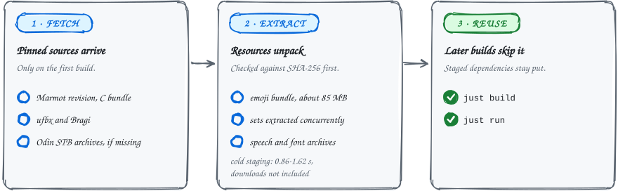

<sub>GUIDE&ensp;·&ensp;BUILDING FROM SOURCE</sub>

# Building from source

### Two commands build it; the first one also fetches the dependencies.

Install the tools with Nix or your distribution, then run `just build` and `just run`. The second half of this page is for maintainers: cross builds, releases and signing keys.

<picture>
  <source media="(max-width: 600px) and (prefers-color-scheme: dark)" srcset="../assets/docs/building-first-build-narrow-dark.svg">
  <source media="(max-width: 600px)" srcset="../assets/docs/building-first-build-narrow-light.svg">
  <source media="(prefers-color-scheme: dark)" srcset="../assets/docs/building-first-build-dark.svg">
  
</picture>

## Build it with Nix on x86-64 Linux

The repository's flake supplies the native build tools and libraries in an FHS environment; it does not require a global `nix-ld` setup. From this checkout, enter the interactive shell and use the existing build commands:

```sh
nix --extra-experimental-features 'nix-command flakes' develop
just build
just run
```

For a single command, use the app entrypoint instead of `nix develop -c`, because the FHS shell hook consumes command arguments:

```sh
nix --extra-experimental-features 'nix-command flakes' run . -- odin version
```

| Tool | Version in the flake |
| --- | --- |
| Odin | upstream dev-2026-10 release binary, the same compiler CI uses |
| OLS | dev-2026-10, pinned through the nixpkgs lock |
| Rust | 1.97.1; install that toolchain with `rustup` if it is not already available |
| Cargo output | `target/nix` in the working directory, unless `CARGO_TARGET_DIR` is set |

Running the GUI still needs the host desktop session, display/audio sockets, and GPU devices. The shell preserves access to host desktop resources, including Omarchy Compose data when present. It uses the host driver set on NixOS and Nix Mesa elsewhere. The first build still downloads the project's pinned source dependencies and resource bundles described below.

## Build it with your distribution's packages

You need:

- **`just` and the [Odin dev-2026-10 release binary](https://github.com/odin-lang/Odin/releases/tag/dev-2026-10).** MDK compiles its Markdown parser with Odin and requires `odin version` to report commit `84bc3fc`; distribution packages may not.
- **A C and C++ compiler, CMake, and a Rust toolchain.** Marmot's C bundle is built from source.
- **SDL 3.4 or newer and the media libraries the viewers bind.** Flatpak bundles SDL because the GNOME 50 SDK ships SDL 3.2.

**Debian / Ubuntu** (SDL3 needs 25.04 or newer, or a source build):

```sh
sudo apt-get install -y just pkg-config cmake clang git curl \
  libsdl3-dev libarchive-dev libmpv-dev libpoppler-glib-dev libcairo2-dev libglib2.0-dev \
  libcurl4-openssl-dev libssl-dev libfreetype-dev libwebp-dev \
  libavformat-dev libavcodec-dev libavutil-dev libswresample-dev zstd
```

**Arch:**

```sh
sudo pacman -S --needed just rust cmake sdl3 libarchive mpv ffmpeg poppler-glib cairo glib2 curl openssl freetype2 libwebp zstd
```

**Then:**

```sh
git clone https://relay.ngit.dev/npub1ven4zk8xxw873876gx8y9g9l9fazkye9qnwnglcptgvfwxmygscqsxddfh/darkmatter-linux.git
cd darkmatter-linux
just build
just run
```

## What the first build downloads and unpacks

The first build clones the pinned Marmot revision and builds its C bundle, fetches ufbx and Bragi, and extracts the SHA-256-pinned emoji bundle with `zstd`. It also builds Odin's STB archives when the installation lacks them. Later builds reuse the staged dependencies.

- **Archives extract without restoring ownership.** The native Linux build unpacks speech, font, and emoji archives this way, so it can run as root inside Flatpak's restricted user namespace.
- **Marmot's OpenSSL stays private.** Native Linux builds, Linux tarballs, and app test binaries hide the symbols in `libmarmot_c.a` from shared libraries. This keeps Marmot's bundled OpenSSL separate from libcurl's shared TLS libraries during certificate verification.
- **The emoji bundle is about 85 MB to download.** It contains each set's PNGs, catalog, licenses and `emoji/<set>.bin` pixel pack; its independently compressed sets are extracted concurrently.
- **Cold staging takes about a second.** Cold font and emoji staging measured 0.86-1.62 seconds on a Ryzen AI MAX+ 395 across three fresh-output runs, including archive verification and extraction, but excluding downloads and without flushing filesystem caches.

The app reads the active set's fixed-size RGBA data at startup (and again when you pick another set in Appearance) and uploads only visible picker rows, so opening, scrolling, and searching do not launch PNG decoders for catalog emoji.

| Emoji pack | Uncompressed size |
| --- | --- |
| Each pack | about 119 MiB |
| OpenMoji, with its own extra emoji | 153 MiB |
| All three | about 391 MiB of resources; only the active one is resident |

They ship beside `emoji-catalog.tsv` in every package.

<details>
<summary><b>Regenerating the emoji bundle, which normal builds never do</b></summary>

Maintainers regenerate the bundle with `bash scripts/emoji-bundle.sh`, using librsvg 2.62.3, cairo 1.18.4 and Odin's STB headers. The script uses the upstream pins in `DEPS_PIN` and fixed archive metadata. Upload its output to the `deps` release, then update `emoji-bundle-file` with the printed SHA-256 and download URL. Normal builds need no SVG renderer or host emoji-packer compilation.

</details>

## Where CI builds run

Trusted Linux CI and release builds run on the two `wn-build-server` slots.

| Builds | Where |
| --- | --- |
| Ubuntu 24.04 native/cross, GNOME 50 Flatpak, Arch | separate Podman environments on `wn-build-server` |
| OpenBSD | a persistent KVM guest |
| Fork PRs | ephemeral GitHub-hosted Linux runners |
| macOS | Apple runners |
| Release publication, pre-commit gate | GitHub-hosted |

<details>
<summary><b>What the build server caches and how it is capped</b></summary>

Each slot retains stamped build outputs, Cargo targets and downloads, and vcpkg archives under `~/.cache/wn-github/`, separated by build environment. The build scripts still validate their inputs, run tests, and boot freshly packaged binaries. Flatpak builds on `master` retain tokenless module state; tagged module state is isolated and deleted after upload. Only dependency outputs pass between those Flatpak builds. Only tag pushes publish releases.

The server's shared build slice caps the two slots at 80% of its 16 CPUs and 50 GiB RAM. A five-second host guard stops CI if available RAM falls below 8 GiB. Individual job containers also have CPU and memory limits.

</details>

## Cross releases for other platforms

`scripts/cross-build.sh TARGET` builds one of these. `WN_TARGET=TARGET scripts/build.sh` invokes the same path; the normal `scripts/build.sh` remains a native Linux build. Each target has separate objects, Rust output, libraries and package files under `build/cross/TARGET`; finished archives go to `dist/`.

| Target | Built on | Notes |
| --- | --- | --- |
| `linux-arm64` | the amd64 Linux container | extracts an Ubuntu 24.04 target sysroot without running ARM compilers |
| `linux-amd64` | the amd64 Linux container | not a cross build, but the same portable tarball recipe as `linux-arm64` |
| `windows-amd64` | the amd64 Linux container | LLVM-MinGW 20260922 with UCRT and libc++; Windows 10 or newer supplies UCRT |
| `darwin-arm64`, `darwin-amd64` | a Mac | Apple's SDK is licensed there |
| OpenBSD amd64 | OpenBSD 7.9 | `scripts/openbsd-build.sh`; there is no cross toolchain for it |

The supplied amd64 Linux container includes the cross compilers and package tools:

```sh
podman build -f packaging/cross/Containerfile -t whitenoise-cross packaging/cross
podman run --rm -v "$PWD:/work" whitenoise-cross linux-arm64    # or linux-amd64
podman run --rm -v "$PWD:/work" whitenoise-cross windows-amd64
```

<details>
<summary><b>What goes into a cross package, and how each piece is pinned</b></summary>

Windows uses LLVM-MinGW paired with Rust's `x86_64-pc-windows-gnullvm` target. Its separate vcpkg triplet avoids reusing GCC/MSVCRT libraries.

Odin emits target objects; the target C linker links the app with Marmot, STB, the app shims and media libraries. Odin compiles Bragi's C API into the `wn-math` object; the C++ linker links it with the Cairo drawing replay shim (`libwnmath.a`) and Cairo.

Source revisions are pinned in `DEPS_PIN`, and Windows/macOS dependency recipes are pinned by the vcpkg baseline in `packaging/cross/vcpkg.json`. FFmpeg includes dav1d for CPU AV1 decoding on Windows and macOS. Speech uses the same pinned upstream sherpa-onnx CPU runtime as the native build.

Packages include the speech/font helpers, curl, their loader dependencies, fonts, emoji data and licenses. The GUST font license is checked in at `assets/fonts/GUST-FONT-LICENSE.txt` and staged locally by native and cross builds, without contacting CTAN mirrors.

</details>

### macOS

macOS bundles build on a Mac, where Apple's SDK is licensed: Xcode or its Command Line Tools supply it, and no Apple account is needed. An Apple silicon Mac builds both architectures; Odin publishes no compiler for Intel Macs. `scripts/macos-setup.sh` installs the pinned tools with Homebrew (GNU userland, bash 5, Odin, Bun, Meson) the way the container does on Linux, and needs Homebrew, rustup and the Command Line Tools already present:

```sh
scripts/macos-setup.sh ~/.cache/whitenoise-macos-tools
source ~/.cache/whitenoise-macos-tools/env
scripts/cross-build.sh darwin-arm64    # or darwin-amd64 for Intel
```

The build uses Xcode's clang with a pinned `-arch` and a macOS 13 deployment target, then signs every Mach-O file and the bundle ad hoc with `codesign`.

### OpenBSD

OpenBSD builds natively on OpenBSD 7.9. `scripts/openbsd-build.sh` lists the packages to install in its header, builds the pinned Odin release from source (OpenBSD has no Odin package), runs `scripts/build.sh`, and packs the install tree as `dist/WhiteNoise-<version>-openbsd-amd64.tar.gz`:

```sh
doas pkg_add bash git cmake ninja gmake coreutils llvm%21 rust unzip-- \
  sdl3 libarchive libwebp mpv poppler cairo curl glib2 ffmpeg zenity libnotify zstd
bash scripts/openbsd-build.sh
```

Run the build as your normal user, with `sudo` or `doas` configured for package staging. The script tests a root-owned installation, including an Xvfb window that resizes and closes under confinement.

- **Rust is older there.** OpenBSD's Rust package (1.94) is older than the toolchain Marmot pins, so `scripts/build.sh` enables the one unstable feature the build needs (`cfg_select`) on OpenBSD.
- **The data size limit goes up.** The build also raises the per-process data size limit, which rustc and Odin's optimizing build otherwise run out of.
- **Reading aloud and dictation are left out.** sherpa-onnx publishes no OpenBSD runtime, so those features report that they could not start.
- **Webxdc is disabled.** `.xdc` attachments remain ordinary downloadable files; the build omits `wn-webview`, and installation removes an older copy.

### Checking cross builds

`.github/workflows/cross.yml` is called by CI and tagged releases. No compiler runs under the emulators it uses.

| Job | What it proves |
| --- | --- |
| Linux ARM64, Windows | extracts the shipped archive and requires a headless launch to produce a screenshot under QEMU or Wine |
| macOS | builds and launches both bundles on Apple silicon, using Rosetta for the Intel bundle |
| OpenBSD | boots the OpenBSD 7.9 image from [cross-platform-actions](https://github.com/cross-platform-actions/action) under QEMU, builds and packages inside it, and launches the packaged binary headless there |

The cross-architecture Linux smoke uses a temporary package view with helper launchers that re-enter QEMU, including helpers launched with an empty environment. It runs the shipped executables and libraries, with only glibc supplied by the target sysroot.

Platform-specific Odin code can be checked from Linux before building a package:

```sh
odin check app -target:windows_amd64 -define:WN_TARGET=windows-amd64
odin check app -target:openbsd_amd64 -vet-unused-imports
```

These commands type-check the app; they do not link it or verify runtime behavior.

## Releasing: one command tags, another announces

<picture>
  <source media="(max-width: 600px) and (prefers-color-scheme: dark)" srcset="../assets/docs/building-release-narrow-dark.svg">
  <source media="(max-width: 600px)" srcset="../assets/docs/building-release-narrow-light.svg">
  <source media="(prefers-color-scheme: dark)" srcset="../assets/docs/building-release-dark.svg">
  
</picture>

`APP_VERSION` in `app/advanced.odin` is `YYYY.M.D+REVISION`, starting at `2026.9.15+1`. Like Android and iOS, the date is the release date and the numeric revision increases for every shipment, including on a new date. Set it before releasing and tag that commit `vYYYY.M.D-build.REVISION` (for example, `v2026.9.15-build.1`). About, diagnostics, AppImage, Flatpak, and Arch packaging use this version.

> [!IMPORTANT]
> Never reuse a published tag.

The app shows the version written in `APP_VERSION` (`app/advanced.odin`); a tag does not change it, and `release.yml` rejects a tag that does not match it. The release commands keep the two together:

| Command | What it does |
| --- | --- |
| `just release` (`scripts/release.sh`) | takes `origin/master` (a dirty checkout or another branch is left untouched), sets `APP_VERSION` to today's date with the next revision (`2026.9.27+1`, then `+2` the same day), commits that on top, tags `v2026.9.27-build.1`, and pushes the result and the tag to both remotes; the tag reaching GitHub starts the release build |
| `just release --dry-run` | prints the version and tag without changing anything |
| `just publish` (`scripts/publish.sh`) | does all of that, waits for the release workflow to publish the GitHub release, then signs its AppImage, Flatpak bundle, and Orchard OCI components with your bunker or nsec |
| `just publish <tag>` | waits for and announces an existing release without creating another one; use it to resume publication after the tag was pushed |
| `bash tests/release-test.sh` | checks the release-to-publish tag handoff with signed commits and local remotes, without publishing publicly |

One NIP-82 release lists all five assets and is sent to `wss://relay.cyberguy.fyi`, `wss://relay.orchard.rocks`, `wss://relay.ditto.pub`, and `wss://relay.zapstore.dev`. Both stores use the publisher in `zapstore.yaml`; `orchard.txt` records that public key for Orchard's repository check.

### Signing the announcement with the White Noise identity

The release publisher is the White Noise identity, `npub1whtn0s68y3cs98zysa4nxrfzss5g5snhndv35tk5m2sudsr7ltms48r3ec`.

1. Run `just publish` (or `just publish <tag>` for a built release).
2. Paste its `bunker://` URL at the hidden signer prompt.
3. Approve the seven NIP-46 signing requests: one kind 32267 listing, five kind 3063 assets, and one kind 30063 release.

The publisher checks the returned signing key before sending each event. The bunker URL stays out of command arguments and shell history; exporting the White Noise private key is not required.

The Flatpak build prepares Orchard's manifest, config, layer, and bootstrap OCI archive from the finished sandbox tree. These files and their checksums are hosted on the GitHub release; a registry account and another signing key are not needed. Preparation uses the Orchard revision in `DEPS_PIN` and does not publish events. The signed announcement happens during `just publish`, so a tag push alone does not add a version to Orchard.

## Release signing keys

The public keys are committed; private keys stay in Actions secrets and maintainer backups. Missing or mismatched release keys fail packaging.

| Platform | Secret | Matches | Without it |
| --- | --- | --- | --- |
| Windows | `JSIGN_*` (below) | not applicable | packages are unsigned |
| AppImage | `WN_APPIMAGE_SIGNING_KEY`, an armored GPG private key | `packaging/appimage-update-key.asc` | packaging fails |
| macOS | `WN_SPARKLE_PRIVATE_KEY`, a base64 Ed25519 seed | `packaging/sparkle-public-key.txt` | packaging fails |

<details>
<summary><b>Windows: unsigned until someone configures jsign</b></summary>

Tagged releases publish the Windows installer, the portable zip, and Velopack's feed (`releases.win.json`, `assets.win.json`, `RELEASES`, and the `.nupkg` packages) to the GitHub release. The job first downloads the previous release so Velopack can also publish a delta package.

Windows packages are unsigned unless `JSIGN_STORETYPE` is configured. Unsigned builds may trigger Windows publisher and SmartScreen warnings. To enable Authenticode signing with [jsign](https://ebourg.github.io/jsign/), set:

| Name | Kind | Value |
| --- | --- | --- |
| `JSIGN_STORETYPE` | repository variable | jsign's `--storetype`, for example `PKCS12` or `TRUSTEDSIGNING` |
| `JSIGN_ALIAS` | repository variable | required with `JSIGN_STORETYPE` |
| `JSIGN_STOREPASS` | secret | required with `JSIGN_STORETYPE` |
| `JSIGN_KEYSTORE_BASE64` | secret, or the next one | a base64 keystore file, such as a `.p12` |
| `JSIGN_KEYSTORE` | secret, or the previous one | a cloud keystore name or endpoint |

Local builds sign when the same `JSIGN_*` variables are passed to the container. Staging builds (a non-release version) keep a plain zip and never join the update feed.

</details>

<details>
<summary><b>AppImage: a GPG key and a separately built updater</b></summary>

`scripts/sign-appimage.sh` embeds the identity of `WN_APPIMAGE_SIGNING_KEY` and the signature in the image. Build its isolated updater with `scripts/build-appimage-updater.sh` and stage with `WN_PACKAGE_APPIMAGE=1 scripts/install-tree.sh AppDir/usr whitenoise`. Ordinary Linux builds compile only the small process bridge and do not build or ship the delta updater. The updater closes its GPG context before removing the temporary keyring, including when an unsigned or invalid image is rejected.

</details>

<details>
<summary><b>macOS: Sparkle signs the updates, not the app</b></summary>

Each architecture publishes its own signed update archive and `appcast-<arch>.xml` on the GitHub release. Sparkle archive signatures authenticate updates independently of the bundle's ad-hoc code signature; they do not add Developer ID signing or notarization.

</details>

### Backing up the keys in KeePass

To store a generated key backup in KeePass, close that database in the GUI and run:

```sh
scripts/store-release-keys.sh /path/to/passwords.kdbx /path/to/key-backup
```

The script uses the native or Flatpak KeePassXC CLI and prompts for the database password. It creates `White Noise release signing keys` with the AppImage private key, Sparkle seed and Sparkle PEM as attachments, then reads each one back for comparison. Reruns verify existing attachments and add missing ones, but stop if a stored key differs. Nothing is overwritten; source keys are not deleted. Pass KeePassXC unlock options after the two paths if needed, for example `-k /path/to/keyfile` or `--no-password`.

## Staging releases on ngit

ngit staging uses `.ngit/act/workflows/release-cross.yml` alongside the existing x86-64 AppImage workflow. The act worker needs Podman with working user namespaces and permission to build and run nested containers. Each target is passed to `actions/upload-artifact`.

- **It has no macOS job yet.** Those need a Mac act runner, and until one exists macOS bundles come from the GitHub workflow.
- **Blossom publication needs coordinator settings.** It requires the coordinator's `--blossom-servers` setting and an artifact-size limit large enough for the archives (`--blossom-max-artifact-bytes`, commonly above the default 64 MiB).

<sub>[Back to the README](../README.md#further-reading)</sub>
