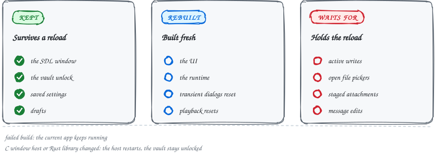
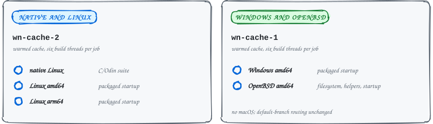

<sub>MAINTAINERS&ensp;·&ensp;DEVELOPMENT</sub>

# Development

### Reload the code, keep the window, and let the caches remember the rest.

This page covers the `just` commands, the rules tests must follow, and how builds stay fast. Install the git hooks before your first commit.

<picture>
  <source media="(max-width: 600px) and (prefers-color-scheme: dark)" srcset="../assets/docs/development-reload-narrow-dark.svg">
  <source media="(max-width: 600px)" srcset="../assets/docs/development-reload-narrow-light.svg">
  <source media="(prefers-color-scheme: dark)" srcset="../assets/docs/development-reload-dark.svg">
  
</picture>

## Six commands cover the daily loop

```sh
just                   # list commands
just build             # build
just test              # build, then run the tests
just dev               # rebuild code in-process, keeping the window
just test-reload       # check reload, unlock, and failed-build recovery
just translations      # regenerate the gettext catalogs
```

`just dev [data-dir]` and `just run [data-dir]` accept an optional data directory. The shell implementations live under `scripts/`; CI and packaging call them directly.

## What `just dev` keeps across a reload

`just dev` keeps the SDL window and vault unlock across code reloads. It rebuilds the UI and runtime from saved settings and drafts, so transient dialogs and playback reset.

- **Reload waits for you.** It holds for active writes and file pickers, and until you send or clear staged attachments and finish message edits.
- **Failed builds change nothing.** The current app keeps running.
- **Native changes restart the host.** Editing the small C window host or the Rust library restarts the host; the vault stays unlocked for the `just dev` session.
- **Release builds ignore the dev unlock cache.** Normal release builds do not accept it.

## Tests run the same checks as CI

All tests live under `tests/`; `just test` runs the same checks as CI. For a focused Odin run, use `tests/odin.sh app [odin test flags]` or `tests/odin.sh app/sdlrl`. The runner assembles a temporary package so tests retain access to private symbols.

End-to-end testing (a QEMU VM harness, a headless control daemon, and multi-VM messaging scenarios) lives in the separate [`darkmatter-automated-testing`](https://github.com/marmot-protocol/darkmatter-automated-testing) repo, which builds this checkout.

## Fixture rules that keep the suite from stalling

- **Release the vault before the home lock.** Vault fixtures must release `g_vault` with `vault_lock()` or `vault_delete()` before releasing `test_home_lock`. The test allocator resets after each test; strings left in the vault let a later worker free them with the wrong allocator.
- **Registries use the runtime allocator.** Theme and font registries outlive individual tests, so fixtures that populate them use `runtime.default_context().allocator`.
- **Take `nendo_test_mutex` first.** Tests that replace `g_ui` take `nendo_test_mutex` before `test_home_lock` when both are needed.
- **Expect, do not fail, under a lock.** Use nonfatal expectations while holding these locks: Odin's `fail_now` skips deferred unlocks and can stall the suite.
- **Mention chips touch the profile caches.** Mention-chip fixtures also populate the global profile caches. Use the runtime allocator and defer `profile_session_clear()` while holding `nendo_test_mutex`.
- **Composer wrapping uses the process heap.** It allocates its cache there without changing the caller's allocator. Mention measurement can queue profile reads; those IDs must stay on the UI heap that frees completed batches.
- **Closed avatar covers stay in layout flow.** That way sidebar mentions retain both the preview's horizontal clip and the chat list's vertical clip. Only a partly open cover floats over its revealed fingerprint.

## Translations go through `tr()`

Use `tr("text")` for UI strings and `tr("%d item", "%d items", count)` for counted labels, then format the returned string with the count. The counted form selects the first catalog entry for one and the second for every other count. Run `just translations` to extract both entries.

| Language | Singular and plural |
| --- | --- |
| English, Italian, German | Distinct entries |
| Japanese, Korean | Same translation for both |

`tr()` does not interpret gettext `Plural-Forms` expressions. Adding a language with other count rules requires extending `tr()`.

## Install the git hooks before your first commit

The hooks are **required**:

```sh
scripts/install-hooks.sh
```

This points `core.hooksPath` at the tracked `.githooks/` directory and registers the `po-clean` catalog filter, so the same checks CI enforces run locally before you commit. The `pre-commit` hook normalizes and validates staged gettext catalogs (stripping source-line references and the volatile `POT-Creation-Date` header so unrelated line shifts never surface as diffs), and keeps the GitHub mirror of the ngit-ci gate in sync. Needs `gettext`.

In a real emergency you can bypass a single commit with `git commit --no-verify`, but CI runs the same checks, so the bypass only defers them.

## One file pins MDK and every other dependency

To build against a different Marmot revision, edit `mdk-commit` in `DEPS_PIN`; the next `just build` re-checks it out and rebuilds the C bundle. Every pinned third-party revision lives in that one file.

The current pin is MDK master at `c8210585cab6` (0.14.0-dev). The build applies the patches listed in `scripts/build.sh`.

- **Upstream now carries the old patches.** NIP-46 C sessions, Windows portability, OpenBSD sandbox support, SOCKS5 routing, and Markdown timestamps come from upstream MDK.
- **Deployments are explicit.** The app supplies White Noise's deployment services when creating the Marmot client; every C constructor requires a deployment.
- **History uses MDK's replay.** History catch-up uses MDK's ordered replay and account-owned recovery. The `retry-convergence` dev command retries convergence for the selected group.
- **Polls are native.** Poll creation, voting, and tallies use MDK's native poll APIs and timeline projection. `patches/mdk-poll-context.patch` preserves thread and issue context through native creation. MDK supports poll creation in direct and group conversations, and a multiple-choice vote must retain at least one selection. Poll cards stay compact in wide chats and wrap option labels in narrow panes; checkmarks identify your selections.

<details>
<summary><b>Staging and validating the patch series</b></summary>

Staging recognizes an already-applied prefix of the patch series and applies only the remaining patches. Appending a patch does not require resetting `vendor/mdk`, even when earlier patches overlap. Local edits outside the files touched by the patches are preserved. Conflicting local edits still stop staging.

Validate MDK patch changes by applying the full `MDK_PATCHES` list, in order, to a clean checkout of `mdk-commit`, then checking the already-patched tree. A successful reverse check alone can hide an invalid old-file path.

Run `bash tests/mdk-patches-test.sh` to check fresh staging, reruns, appended overlapping patches, preserved unrelated source edits, and conflicting local edits.

</details>

## Keep the build caches between builds

Keep `build/cargo/native` and `build/cross/<target>/cargo` between builds. Cargo checks MDK's inputs on each build and reuses unchanged crates across MDK pin and patch changes. An MDK-only change relinks the app without recompiling its Odin sources.

<details>
<summary><b>What each cache key covers, and what invalidates it</b></summary>

- **Cargo.** Rust and C/C++ compiler versions, target, and build flags select separate cache directories. `CARGO_TARGET_DIR` selects the native cache root; the build appends its compiler-environment fingerprint.
- **Cross dependencies.** Cross builds also retain the target sysroot, SDL, speech runtime, and vcpkg outputs. Their stamps include the inputs that produced them; changing those inputs rebuilds the affected dependency.
- **CI restores.** CI restores Cargo state from older source revisions within the same compiler/target boundary, rather than treating a previously staged Marmot library as proof that its inputs are unchanged.
- **C/C++ helpers and Odin outputs.** Native and cross builds cache these by input contents, compiler, target, and flags. Output manifests detect missing or corrupted files and reject dangling links.
- **SDK symlinks.** Dangling SDK symlinks contribute their link metadata to input keys; resolving or retargeting them invalidates the cache.
- **Odin objects.** Native Linux/OpenBSD and cross builds cache Odin objects separately from linking.
- **Packages.** Linux and Windows package caches cover bundled runtime libraries and archives; release downloads, signing, and update feeds still run when requested.

</details>

## Five CI jobs, two runner slots, two warm caches

<picture>
  <source media="(max-width: 600px) and (prefers-color-scheme: dark)" srcset="../assets/docs/development-ci-narrow-dark.svg">
  <source media="(max-width: 600px)" srcset="../assets/docs/development-ci-narrow-light.svg">
  <source media="(prefers-color-scheme: dark)" srcset="../assets/docs/development-ci-dark.svg">
  
</picture>

The build-server workflow builds native Linux, Linux amd64/arm64, Windows amd64, and OpenBSD amd64 once each. It runs the native C/Odin suite, packaged Linux and Windows startup tests, and OpenBSD's filesystem, helper, and startup tests.

<details>
<summary><b>Slots, signing keys, and the math helper's own cache</b></summary>

- **Scheduling.** The workflow queues these five jobs together on two isolated runner slots, with six build threads per job and shared CPU/memory limits. Native and Linux jobs use `wn-cache-2`; Windows and OpenBSD use `wn-cache-1`. This keeps targets on warmed caches while both slots can build concurrently.
- **Signing keys.** The native runner signs temporary Git fixtures with a dedicated CI test key. The MDK patch-staging test generates its own temporary SSH signing key.
- **Bragi.** Bragi's math-helper object is cached per target and slot, including its sources, font, toolchain, and build flags. Unrelated application edits do not rebuild it.
- **SDK tracking.** Native SDL, Odin overlay, and Odin object keys track SDK headers and versions separately from shared-library contents. OpenBSD's boot-time library reordering invalidates linked executables, not these compiled outputs.
- **Scope.** The workflow does not change the default-branch runner routing or include macOS.

</details>

## Observability tokens come from CI secrets

Publishing workflows read `WN_METRICS_WRITE_TOKEN` and `WN_AUDIT_WRITE_TOKEN` from CI secrets. Configure both on GitHub and on trusted ngit/act publishing runners, not PR runners. Local builds without them contain no write tokens.

> [!CAUTION]
> Embedded tokens stay out of source and build logs, but they remain extractable from published binaries. Keep them write-only and narrowly scoped.

- **Embedding.** The build embeds a generated, mode-0600 `build/observability-tokens.toml`; CI removes that file before cache and artifact uploads.
- **Format.** Tokens must be printable ASCII without double quotes or backslashes.
- **Per-user overrides.** The optional per-user `observability.toml` overrides embedded settings; protect credentials in that file with mode 0600. On macOS it lives under `~/Library/Application Support/whitenoise/`; on Windows, under `%LOCALAPPDATA%/whitenoise/`.
- **Consent still applies.** Uploads still require the corresponding consent setting.

See [timing and observability configuration](timings.md).

## A flat architecture, rebuilt every frame

```
 SDL3  ←──  app/sdlrl/  ←──  app/renderer.odin  ←──  nendo layout (app/*.odin)
                                                          │
                                                    app/state.odin  (Ui_State)
                                                          │
                                              app/workers.odin  (worker threads)
                                                          │
                                                   marmot/marmot.odin
                                                          │
                                            marmot-c  →  the Marmot runtime
```

It reads flat by intent. The layout is immediate-mode: every frame rebuilds the nendo tree by reading one `Ui_State` struct, so there is no retained view tree, no widget objects, and no observer graph to trace. Panes are plain procs.

| Path | What's there |
| --- | --- |
| `app/` | The whole app: panes, layout, state, workers, vault, media viewers |
| `app/state.odin` | `Ui_State`, the single struct every pane reads, plus the live theme globals |
| `app/chatpane.odin` | Chat-pane rendering, group info, and the composer |
| `app/loginpane.odin` | Sign-in and key-generation UI, with button and progress helpers |
| `app/workers.odin` | Live subscriptions, sends, member loading, and other blocking Marmot calls kept off the UI thread |
| `app/sdlrl/` | SDL3 shim with a raylib-shaped API: window, input, IME, clipboard, and a stb_truetype text engine |
| `app/nendo/` | nendo, White Noise's layout engine |
| `app/vault.odin` | The password-encrypted secret vault |
| `marmot/` | The `marmot-c` bindings, the only place that touches C |
| `app/password.odin` | The allocation-free password-strength heuristic and input cache |
| `tests/smoke/` | Standalone liveness check for the bindings against a fresh home dir |
| `themes/` | The theme packs, `#load`ed at build time |
| `lang/` | gettext catalogs (`en` source, plus `it`, `de`, `ja`, `ko`), `#load`ed at build time |
| `assets/` | Logo, fonts, and the SVG starter-avatar set |

## Design choices to know before you dig in

- **Optimistic rendering.** Sending, reacting, and unreacting apply locally and repaint immediately, then reconcile against Marmot's response. The UI never blocks on the network round-trip.
- **Two upload paths.** Chat attachments go through Marmot's encrypted MIP-04 path, readable only by group members. Profile pictures take the deliberately public Blossom path.
- **Data-driven themes.** Every color, metric, and capability flag comes from a `themes/*.toml` pack. The parser and editor share one token-to-field table in `app/theme.odin`; `app/state.odin` owns the live colors. A new component reads the globals; it never branches on which theme is active. Fullscreen media uses `media-backdrop` and `media-chip-bg` for its backdrop and floating header.
- **Standard math.** Motion, decoration and sound synthesis call `core:math` directly, evaluating `f64` phases before narrowing to `f32`. Checkmark strokes use `math.sqrt` with a minimum normalization length of 0.001.

## Sidecar themes are pinned to one commit

Sidecar palettes, title faces, and background artwork are pinned to `3aaebf9dc7beb9924c6e1f9bc060cecbc1be6f8f`. Run `bun scripts/render-sidecar-themes.ts` with Chromium installed to regenerate the embedded 1280×800 background images from the source CSS and SVGs.

- **Backgrounds crop, never stretch.** They keep their aspect ratio and fill the window, centered with excess cropped at the edges.
- **Some browser effects are dropped.** Browser animations and component-surface gradients are not reproduced, and the native text engine does not provide browser OpenType shaping.
- **Two font slots.** `font-title` selects a bundled display face separately from the body `font`.
- **Licences ship with the fonts.** Font licences, source hashes, and conversion details are in `assets/fonts/sidecar/` and installed with the fonts.

For the deeper details, see [`AGENTS.md`](../AGENTS.md).

<sub>[Back to the README](../README.md#further-reading)</sub>
