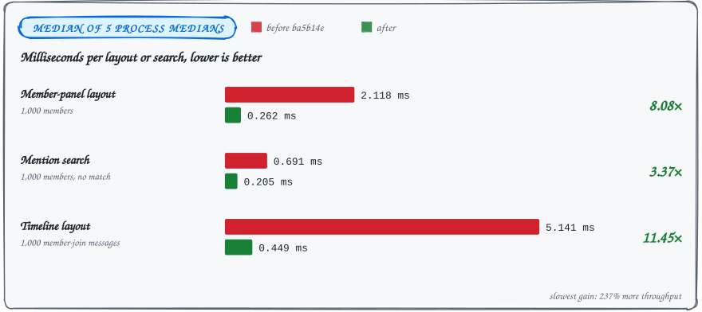

<sub>BENCHMARK&ensp;·&ensp;LARGE GROUPS</sub>

# Large-group UI performance

### A thousand members, and the panel now draws about fifteen of them.

Three UI workloads with 1,000 members got 3.37 to 11.45 times faster. These are local layout and search times, not relay or decryption speed.

<picture>
  <source media="(max-width: 600px) and (prefers-color-scheme: dark)" srcset="../assets/docs/large-group-performance-results-narrow-dark.svg">
  <source media="(max-width: 600px)" srcset="../assets/docs/large-group-performance-results-narrow-light.svg">
  <source media="(prefers-color-scheme: dark)" srcset="../assets/docs/large-group-performance-results-dark.svg">
  
</picture>

## The measured medians

| Workload | Before | After | Speedup |
| --- | ---: | ---: | ---: |
| Member-panel layout, 1,000 members | 2.118 ms | 0.262 ms | 8.08× |
| Mention search, 1,000 members, no match | 0.691 ms | 0.205 ms | 3.37× |
| Timeline layout, 1,000 member-join messages | 5.141 ms | 0.449 ms | 11.45× |

The slowest measured improvement is 237% greater throughput. These numbers measure local UI work, not relay latency, message decryption, first-open database latency, GPU presentation, or overall application speed on a real account.

<details>
<summary><b>How the numbers were taken</b></summary>

| Setting | Value |
| --- | --- |
| Date | 2026-09-22 |
| CPU | AMD Ryzen AI MAX+ 395 |
| Odin | `dev-2026-09:a2fb372b7`, `-o:speed` |
| Display | SDL dummy video driver, 1200×800 |
| Baseline | `ba5b14e` |
| Samples | 31 per process, after five warmup layouts |
| Reported value | Median of five process medians |

Baseline and changed builds alternated, with no compilation running during measurement.

</details>

## What stopped happening per frame

- **The member panel builds only the rows you can see.** It used to build every avatar and name on every frame; it now builds 13–16 detailed rows in the tested viewports and keeps fixed-height placeholders for scroll geometry.
- **System messages joined timeline virtualization.** They used to bypass it; they now use the same measured heights as chat rows.
- **Mention search stops re-encoding npubs.** It reuses the member's stored npub instead of encoding it on every unsuccessful name comparison.
- **Chat selection drops a query nobody read.** It fetched all members only to fill a field that had no readers. That runtime query is gone: one call per switch becomes zero.
- **Member loading moved off the UI thread.** Member-panel and mention loading fetch group details on a worker, discard results for obsolete account/group selections, and join workers at shutdown.
- **Member snapshots free their strings.** They release them when replaced or when you leave a chat.

## Run the checks yourself

This runs the benchmark plus the scroll, narrow-layout, nickname, and search checks:

```sh
SDL_VIDEODRIVER=dummy tests/odin.sh app -o:speed \
  -define:WN_PERF=true -define:ODIN_TEST_NAMES=large_group_layout
```

| Command | Also checks |
| --- | --- |
| `just test` | Snapshot ownership and stale worker completions |
| `just test-reload` | Shutdown and module replacement |

## The follow-up: no database scans on the UI thread

- **Periodic scans are gone.** The follow-up removes periodic chat-list and mentions-inbox database scans from the UI thread.
- **Live events share one reader.** They coalesce behind one chat-list reader; account changes and explicit refreshes invalidate older results.
- **Previews use what they were given.** System-message previews use the supplied event instead of rereading its timeline.
- **Marking read is cheaper.** It no longer reloads the entire chat list or saves unchanged prefs.

## Scrolling holds still while messages arrive

Incoming messages now preserve the viewport while you read older messages. Scroll-anchor and jump corrections render in the same frame, so you never see one frame at the old offset.

Row measurements use the offset captured for layout, so anchor corrections cannot undo a scrollbar drag made during that layout.

<details>
<summary><b>What the regression tests hold down</b></summary>

The regressions cover a blocked reader, stale results, mention filtering, and arrivals while scrolled away from the bottom. The large-group test holds the mouse down across four thumb positions and checks three frames at each position before release.

</details>

<sub>[Back to the README](../README.md#further-reading)</sub>
