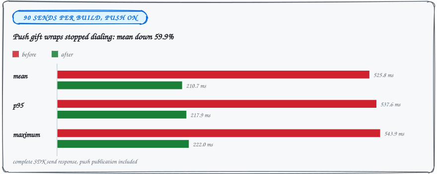
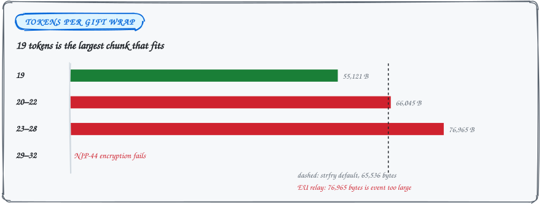

<sub>INVESTIGATION&ensp;·&ensp;SENDING</sub>

# Outbound latency investigation, 2026-09-21

### Every push notification dialed its own relay connection while the message waited.

Push-enabled sends now reuse connected subscription sockets for their signed notification gift wraps. Mean caller response fell 59.9%, from 525.8 ms to 210.7 ms.

<picture>
  <source media="(max-width: 600px) and (prefers-color-scheme: dark)" srcset="../assets/docs/outbound-latency-response-narrow-dark.svg">
  <source media="(max-width: 600px)" srcset="../assets/docs/outbound-latency-response-narrow-light.svg">
  <source media="(prefers-color-scheme: dark)" srcset="../assets/docs/outbound-latency-response-dark.svg">
  
</picture>

## Push gift wraps now share the subscription sockets

Previously notification publishing opened a separate connection after message publication, occupying the account worker until it finished. The existing signer-bound fallback still handles disconnected endpoints and explicit authentication rejection.

| Caller response, 90 sends per build | Before | After |
| --- | ---: | ---: |
| Mean | 525.8 ms | 210.7 ms |
| p95 | 537.6 ms | 217.9 ms |
| Maximum | 543.9 ms | 222.0 ms |

Mean response decreased 59.9%. This measures the complete SDK send response, including push publication. It does not establish cross-platform rankings or explain every historical queue stall.

- **Three alternating pairs.** Baseline/candidate pairs used isolated two-member groups, 30 sequential messages per run, and the EU and US White Noise relays.
- **One difference.** Both builds included the unchanged-subscription guard below; the only measured network-path difference was notification connection reuse.
- **Delivery checked.** Each send required a relay acknowledgement and independent receiver decryption.
- **Conditions.** Release builds, no injected delay, push enabled with a synthetic token and generated server key.

```sh
cd vendor/mdk
SEND_PUSH=1 SEND_RELAYS=wss://relay.eu.whitenoise.chat,wss://relay.us.whitenoise.chat \
  CC=clang cargo test --release --locked -p marmot-app --test relay_runtime \
  send_connection_reuse -- --ignored --nocapture
```

<details>
<summary><b>On loopback the reuse made sends slower</b></summary>

Without `SEND_RELAYS`, the diagnostic uses a local relay and counts connections. With `SEND_PUSH=1`, it also fetches and decrypts all 30 notification gift wraps. Both public-relay and loopback delivery checks passed.

Loopback opened zero connections during the candidate's 30 sends, versus 30 before. Its mean was 56.6 ms versus 36.3 ms before, so the latency improvement is specific to the measured remote-relay workload.

The final local fixture allows 1,000 events per minute: setup plus 30 messages and 30 pushes exceeded the mock's default 60-event allowance on one connection.

</details>

## Unchanged subscription syncs return early

Unchanged subscription syncs now return before rebuilding the routing index. The lifecycle lock and pending-unsubscribe retry remain in place. A separate release benchmark measured sync alone, excluding request cloning, after ten warmups with 100 samples per group count:

| Groups | Before median | After median |
| --- | ---: | ---: |
| 1 | 0.001803 ms | 0.000180 ms |
| 100 | 0.163177 ms | 0.005139 ms |
| 1,000 | 1.708731 ms | 0.051287 ms |

Reproduce with `cargo test --release --locked -p transport-nostr-adapter
--test inbound_routing unchanged_sync_latency -- --ignored --nocapture`.

## What production dashboards could and could not say

The [Arena outbound panels](https://grafana.ipf.dev/d/mdk-app-arena/mdk-app-arena?from=now-7d&to=now&var-env=production) combine Linux commits under `2026.9.15+1`. That label cannot isolate a build. Read-only production queries on September 21 returned these means:

| Stage | Seven days | Last 24 hours | Last three hours |
| --- | ---: | ---: | ---: |
| Queue wait | 6,622.6 ms | 207.5 ms | 449.2 ms |
| Send execution | 1,081.3 ms | 972.0 ms | 888.9 ms |
| Local accept | 12.4 ms | 24.9 ms | 19.9 ms |
| Publish | 775.4 ms | 578.1 ms | 379.5 ms |
| Caller response | 7,704.3 ms | 1,179.9 ms | 1,338.6 ms |
| Send samples (approximate) | 203 | 39 | 18 |

Counts use Prometheus `increase`, including its boundary extrapolation. These are different workloads, not a before/after comparison.

The recent queue delay still needs a controlled reproduction. Storage transaction mean was 0.17 ms over 24 hours, while worker convergence averaged 1,276.5 ms. Aggregate timings alone cannot identify which operation blocked a send.

## Group size and the pending row

The existing `active_group_send_timings` release diagnostic passed on the local working tree with a loopback relay.

| Group members | Caller mean | Samples |
| ---: | ---: | ---: |
| 2 | 36.5 ms | 14 |
| 5 | 59.4 ms | 35 |
| 9 | 138.1 ms | 63 |

Twenty-six sends returned accepted-pending during group changes; every measured row eventually obtained a published source. This checks SDK state, not rendering or independent receiver decryption, and does not establish a platform lead.

- **The new row scrolls into view.** The host fix requests bottom scrolling when text, files, or image albums enter the pending list. Previously the row could remain below the viewport until another update or manual scroll.
- **Sending no longer rebuilds the timeline.** The composer stops rebuilding the retained timeline on send: one full projection becomes zero on that path. Subscriptions and the existing completion fallback still reconcile messages.
- **Tested without a client.** `tests/odin.sh app -define:ODIN_TEST_NAMES=send_reveals_preview` checks the scroll request without a usable client. It fails against the previous send code. `just test` covers the existing acknowledgement handoff as well.

No deployed latency improvement is claimed until fresh production samples exercise this change.

## Large push groups

The protocol permits 32 encrypted tokens in a notification rumor, but the twice-encrypted NIP-59 envelope has tighter limits. The old 32-token chunks failed encryption with `message too long`. Direct serialization measured:

<picture>
  <source media="(max-width: 600px) and (prefers-color-scheme: dark)" srcset="../assets/docs/outbound-latency-chunks-narrow-dark.svg">
  <source media="(max-width: 600px)" srcset="../assets/docs/outbound-latency-chunks-narrow-light.svg">
  <source media="(prefers-color-scheme: dark)" srcset="../assets/docs/outbound-latency-chunks-dark.svg">
  
</picture>

| Tokens per gift wrap | Serialized event |
| --- | ---: |
| 19 | 55,121 bytes |
| 20–22 | 66,045 bytes |
| 23–28 | 76,965 bytes |
| 29–32 | NIP-44 encryption fails |

The EU White Noise relay rejected a 76,965-byte event as `event too large`. Publishing now uses 19-token chunks, below [strfry's default 65,536-byte event limit](https://github.com/hoytech/strfry/blob/master/strfry.conf). The protocol's 32-token validation bound remains unchanged. The regression test decrypts every chunk, checks the complete token sequence, and caps the serialized event size.

- **Four in flight per push server.** Notification publishing keeps at most four chunk operations in flight per push server.
- **One publisher, same path.** It resolves the account publisher once and uses the existing single-event publication path, preserving connection reuse and authenticated fallback.
- **Every chunk drains.** It drains every chunk before returning an error. MLS mutation, durability, and send-completion semantics are unchanged.
- **Batch publishing was rejected.** The SDK's batch publisher waits for all endpoints to connect before publishing, allowing a stalled relay hint to hold up a healthy relay. The local regression scenario includes both a healthy relay and a TCP listener that never completes its WebSocket handshake.

### Notification stage timings by token count

One candidate run followed by one serial-baseline run against the EU relay produced these means (eight measured calls per cell):

| Tokens | Shared before | Shared after | Write-only before | Write-only after |
| --- | ---: | ---: | ---: | ---: |
| 32 | 216.9 ms | 150.6 ms | 892.4 ms | 471.1 ms |
| 33 | 216.5 ms | 143.2 ms | 892.3 ms | 486.7 ms |
| 128 | 707.0 ms | 280.2 ms | 3,240.5 ms | 718.5 ms |
| 512 | 2,700.1 ms | 819.6 ms | 12,957.9 ms | 1,355.6 ms |

With shared connections, the notification stage was 2.5 times faster at 128 tokens and 3.3 times faster at 512. Write-only mode shuts down the subscription pool to force account publishing; its larger gain also includes avoiding repeated publisher construction and connection setup inside one trigger. Every envelope was independently decrypted in both builds. This single before/after pair does not establish an end-to-end large-group speedup or a production latency distribution.

With the final 19-token chunks, loopback median time at 512 tokens fell from 20.42 to 15.07 ms on shared connections and from 21.80 to 15.50 ms on the write-only path. Earlier, larger-chunk experiments hit approximately 40 ms loopback stalls; disabling Nagle on the test relay's accepted sockets removed them. Final comparisons used the stock relay without socket overrides or injected delays. The larger remote gain is workload-dependent.

<details>
<summary><b>The <code>push_batch_scaling</code> diagnostic and its flags</b></summary>

The ignored `push_batch_scaling` diagnostic invokes notification publication with synthetic stored tokens, then independently fetches and decrypts every gift wrap. It measures the notification stage, not complete message sending, queue wait, or the MLS cost of a group containing that many real members. It uses one warmup and eight measured calls per token count and publisher mode. The default is loopback; `PUSH_RELAY` opts into a remote relay:

```sh
cd vendor/mdk
PUSH_RELAY=wss://relay.eu.whitenoise.chat CC=clang \
  cargo test --release --locked \
  --config profile.release.package.cgka-session.debug-assertions=true \
  --config profile.release.package.cgka-engine.debug-assertions=true \
  -p marmot-app --lib push_batch_scaling -- --ignored --nocapture
```

Those package overrides expose legacy profiles required by existing app unit tests; the measured app code remains release-optimized. Both comparison builds use identical flags and the corrected 19-token limit. Comparing with the old oversized chunks would reward failed delivery.

</details>

## Native deployment check, 2026-09-23

The running dev host was still using a C bundle built before these SDK changes. Building Rust tests had not rebuilt `marmot-c` or replaced the host's loaded `libmarmot-dev.so`. Rebuilding through `just build` and restarting the host applied the changes to the native app.

> [!IMPORTANT]
> Passing Rust tests do not update the running app. Rebuild through `just build` and restart the host.

`just dev` now includes `DEPS_PIN`, SDK patches, and the staging script in its native dependency fingerprint. Changes stage the dependencies before compiling Odin; a changed C bundle replaces the shared library and restarts the host. Watching the repository root also catches atomic pin-file replacements.

| Native run | Sends | Queue | Executing | Publishing | Local acceptance |
| --- | ---: | ---: | ---: | ---: | ---: |
| Live process, before replacement | 117 | 23,322 ms | 1,262 ms | 1,214 ms | 7 ms |
| Separate `build/app`, 20-send burst | 21 | | 151 ms | 140 ms | |

The separate native `build/app` instance used a generated account, a notes-to-self group, and the default public relays. One warmup followed by 20 simultaneous sends produced 21 retained messages and zero pending sends. SDK execution averaged 151 ms and publication 140 ms across all 21. The longest Linux worker call was 3,025 ms. The burst still queues behind serialized publications; this is not a same-workload before/after result or a measurement of a large recipient group.

The Linux completion drain also stops rewriting the encrypted offline queue on every frame while an acknowledged send waits for its timeline IDs. It persists only when a pending send settles or fails. The regression keeps ciphertext unchanged while waiting and verifies removal after the complete timeline replacement arrives.

<sub>[Back to the README](../README.md#further-reading)</sub>
