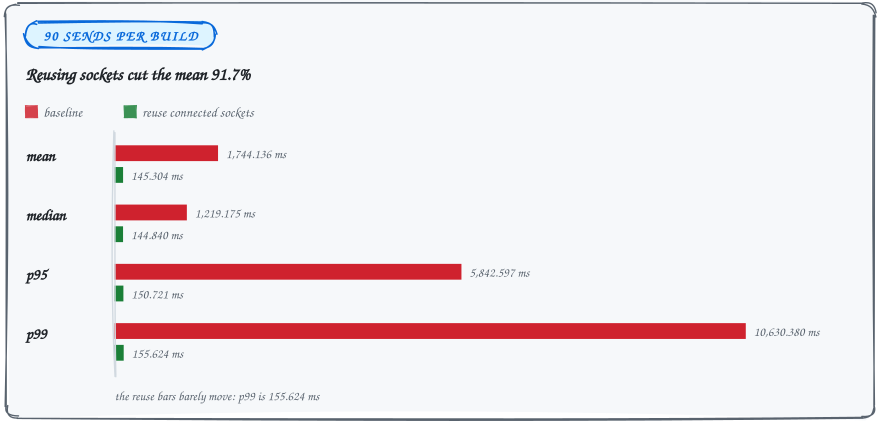

<sub>BENCHMARK&ensp;·&ensp;SENDING</sub>

# Send connection reuse

### The relays were already connected, so sends stopped dialing them again.

On 2026-09-19, 90 real-network sends per build averaged 1,744.136 ms before and 145.304 ms after (91.7% lower). All 180 messages obtained relay acknowledgements and were decrypted by an independent receiving runtime.

<picture>
  <source media="(max-width: 600px) and (prefers-color-scheme: dark)" srcset="../assets/docs/send-connections-latency-narrow-dark.svg">
  <source media="(max-width: 600px)" srcset="../assets/docs/send-connections-latency-narrow-light.svg">
  <source media="(prefers-color-scheme: dark)" srcset="../assets/docs/send-connections-latency-dark.svg">
  
</picture>

## Results across 180 sends

| Build | Mean (ms) | Median (ms) | p95 (ms) | p99 (ms) |
| --- | ---: | ---: | ---: | ---: |
| Baseline | 1744.136 | 1219.175 | 5842.597 | 10630.380 |
| Reuse connected sockets | 145.304 | 144.840 | 150.721 | 155.624 |

Three alternating baseline/candidate pairs each sent 30 messages. Percentiles use nearest rank. Public-network outliers remain in the results, and the [raw samples](send-connections-results.txt) include every measured send.

| Pair | Baseline mean (ms) | Candidate mean (ms) |
| --- | ---: | ---: |
| 1 | 1137.989 | 144.708 |
| 2 | 2854.999 | 145.110 |
| 3 | 1239.421 | 146.094 |

## Which socket a send uses now

The account publisher opened and removed a separate write connection for each publication, although the shared subscription pool was already connected to those relays. Signed events now use that connected pool.

<picture>
  <source media="(max-width: 600px) and (prefers-color-scheme: dark)" srcset="../assets/docs/send-connections-sockets-narrow-dark.svg">
  <source media="(max-width: 600px)" srcset="../assets/docs/send-connections-sockets-narrow-light.svg">
  <source media="(prefers-color-scheme: dark)" srcset="../assets/docs/send-connections-sockets-dark.svg">
  
</picture>

- **Signed events use the connected pool.** No new write connection is opened for them.
- **Some cases keep the account publisher.** Unsigned events, missing or disconnected sockets, and a shut-down pool retain the existing account publisher.
- **Authentication rejections fall back.** An explicit authentication-required rejection retries with the account publisher.

Relay targets, signatures, encryption, persistence, acknowledgement requirements, fanout completion, and telemetry timer boundaries are unchanged. The fanout still waits for every attempted endpoint's outcome. This does not make a local message insertion count as a successful network send.

## Where reuse helps and where it costs

The separate loopback proxy counted 30 new connections before and zero after for 30 sends. With no simulated setup delay, that local test regressed from 8.321 to 26.621 ms mean.

| Test | Before | After |
| --- | ---: | ---: |
| Loopback proxy, new connections per 30 sends | 30 | 0 |
| Loopback, no simulated setup delay, mean | 8.321 ms | 26.621 ms |

Reuse benefits network connection setup; it is not a universal latency improvement. A separate synthetic setup-delay experiment is excluded from the real-network results above.

<details>
<summary><b>How the 180 sends were measured</b></summary>

- **Pinned SDK.** Release builds of pinned MDK `4800db0e2901b5be996f32d095f8aabb6d7ae013`. Existing workspace changes were held constant between builds; only the publishing change differed. Both binaries used the same benchmark harness.
- **Fresh groups.** Each run created two temporary identities, independent storage and runtimes, and a fresh two-member MLS group. After setup, both builds waited two seconds for subscriptions. Measured messages had distinct plaintext.
- **Public relays.** Both default Linux relays were used: `wss://relay.eu.whitenoise.chat` and `wss://relay.us.whitenoise.chat`. No proxy or artificial delay was on this path.
- **Timer boundaries.** Timing starts before `MarmotAppRuntime::send_message` and ends when it returns with a publication. Receiver plaintext is checked before the next send. `received_ms` is the time of that check, an upper bound on actual receipt.
- **No telemetry.** Diagnostics were disabled, and the test binary had no OTLP export feature. Temporary local identity files were removed on normal test completion.
- **One misleading column.** In these logs, `new_connections=0` is an inactive loopback-proxy counter, not a measurement of public connections. The final harness prints `None` instead.

</details>

## Reproduce the benchmark

MDK 0.12.0 ships a reworked version of this change (#1961), so the Linux build no longer patches it. The tests below are upstream. From `vendor/mdk`:

```sh
CC=clang cargo test --release --locked -p marmot-app --test relay_runtime publish_socket_isolation -- --exact
SEND_RELAYS=wss://relay.eu.whitenoise.chat,wss://relay.us.whitenoise.chat \
  CC=clang cargo test --release --locked -p marmot-app --test relay_runtime \
  send_connection_reuse -- --ignored --nocapture
```

> [!WARNING]
> The second command publishes real test traffic. Omit `SEND_RELAYS` for the local connection-count diagnostic.

To build a baseline, retain the identical test harness and reverse only the publishing change in `src/relay_plane/mod.rs`, then build and copy the executable before restoring the publishing change.

## What 145 ms does not prove

The screenshot's 1.3 s iOS mean implies a 1.04 s target for 20% lower latency. 145 ms clears that reference in this workload.

- **Not a paired iOS test.** It is also not a deployed Arena result.
- **The dashboard mixes workloads.** It aggregates different devices, versions, histories, and workloads; its timer also excludes worker queue wait.
- **This benchmark is an easy case.** It includes caller dispatch and queue wait but uses an idle, fresh two-member group.
- **Production still decides.** Production Arena measurement is still needed to claim the requested platform-wide lead. No dashboard queries or metrics were changed.

<sub>[Back to the README](../README.md#further-reading)</sub>
