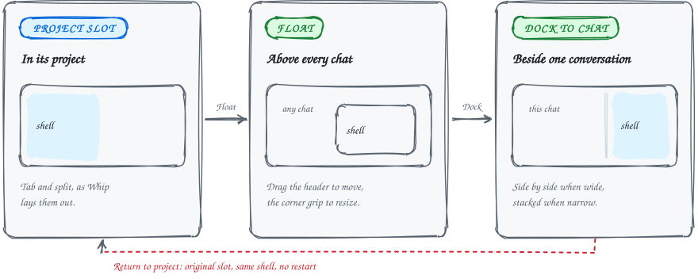

GUIDE&ensp;·&ensp;TERMINALS

# Whip inside White Noise

### Your shells sit in the chat list, and leaving the page leaves them running.

On Linux, native builds can show Whip terminal projects inside Chats. Build Whip first, then rebuild White Noise.

<picture>
  <source media="(max-width: 600px) and (prefers-color-scheme: dark)" srcset="../assets/docs/whip-pane-states-narrow-dark.svg">
  <source media="(max-width: 600px)" srcset="../assets/docs/whip-pane-states-narrow-light.svg">
  <source media="(prefers-color-scheme: dark)" srcset="../assets/docs/whip-pane-states-dark.svg">
  
</picture>

## How White Noise finds Whip

Native builds detect an executable `../whip/build/whip` and its built Ghostty library. While that executable is installed, its projects appear inside Chats with a terminal icon, directory, tab count and selected accent. White Noise attaches to Whip's `default` session, starting its server if needed.

Choose New terminal from the New chat chooser to pick a project folder and open it.

## Where terminals land in the chat list

Chats and terminals share pinned-first, recent-activity ordering, search, Unread and keyboard cycling. The Whip filter shows only terminals.

- **Folders work the same as for chats.** Right-click a terminal to pin it or move it to a folder. Grouped view and the Folders board use the same assignments; an Is Whip folder rule files projects automatically.
- **Recency follows what you do.** It follows your input and newly created projects, tabs and panes.
- **Looking is not activity.** Opening a terminal does not move it up the list. Background output and notifications do not change its recency either.
- **Ties stay put.** Equal timestamps use stable project IDs, so catalog refreshes do not shuffle tied rows.
- **Recency is saved by folder.** Activity while White Noise is detached has no timestamp available from Whip.

## Tabs, panes and headers

White Noise owns the tab strip, pane headers and draggable splitters. Each pane has its own Whip rendering context inside its assigned slot. Tabs and panes can be opened and closed from their native controls.

- **Titles match standalone Whip.** Tab titles follow its naming rules, including live terminal titles and emoji.
- **One compact header.** Project identity, tabs and the new-tab button share it, styled like chats. Hover the project name for its full folder path.
- **Focus borders identify the active terminal.** Split and docked titlebars are hidden until you hover their top edge; their names and controls overlay the terminal without resizing it. Floating titlebars stay visible.
- **The active tab stays in view.** Keyboard tab changes and window resizing keep it visible. The ordinary mouse wheel browses the tab strip horizontally without changing tabs.
- **Drag a tab to reorder it.** The accent marker shows where it will land; holding it at either edge scrolls the strip. Drop outside the strip or press Escape to cancel.
- **Reordering is yours alone.** It keeps the selected terminal open, and numbered and previous/next shortcuts follow the displayed order. White Noise saves this order per account and project for the same running Whip server; standalone Whip's order is unchanged.

## Renaming a project or moving its root

Right-click a terminal and choose Edit project, or click its name in the header, to change its name and root folder. Enter an absolute path or one starting with `~/`.

- **Overrides stay local.** White Noise saves them; running shells and standalone Whip are unchanged.
- **An explicit root stays fixed.** It does not follow the first tab when that tab changes directories.
- **Corrections keep your setup.** Pins, folder assignments, avatars and saved tab order survive.
- **Validation runs in the background.** Your draft stays open if the path needs correcting.

## Float, dock and return

Choose Float in a pane header to keep that shell above chats as you navigate. Drag the header to move it; use the corner grip to resize it.

Dock to chat attaches it to the current conversation, beside the chat on wide windows or below it on narrow ones. That pane appears only with its chat and account. Drag the divider to give the chat or terminal more room; side-by-side widths and stacked heights are remembered separately.

Choose Float to detach it again, or Return to project to restore its original slot and open its tab with shell input focused, without restarting it.

- **Layout survives a restart.** Selected tabs, floating positions and chat docks survive closing White Noise and are scoped to your account.
- **Panes only rejoin their own server.** Saved panes reconnect only to the same running Whip server, so a reused pane number cannot attach a different shell to a chat.
- **Startup restore includes terminals.** The startup restore setting also reopens your last selected terminal. Typing or navigating while the catalog loads takes precedence, and restoring a terminal does not advance its recent-activity position.

## Keyboard shortcuts

Whip's keyboard shortcuts work while its content has focus. Pane focus, zoom, resize, find, clipboard and rename shortcuts keep Whip's bindings.

| Shortcut | Action |
| --- | --- |
| Ctrl+T / Ctrl+W | Open / close a tab |
| Ctrl+Shift+Left/Right | Switch tabs |
| Ctrl+N | Create a project in the focused pane's directory |
| Ctrl+Alt+V, Ctrl+Alt+Minus | Split panes |
| Ctrl+Alt+/ | Open Whip's shortcut help |
| Ctrl+Alt+Q | Return to the inbox without stopping shells |
| Ctrl+Shift+Up/Down | Move between all visible chats and terminals |
| Ctrl+Tab, Ctrl+Shift+Tab | Same as Ctrl+Shift+Up/Down |
| Ctrl+Alt+A | Toggle the Android emulator panel beside the focused terminal |

Ctrl+Shift+Up/Down works whether you start in a chat or a terminal. It follows the sidebar's pin and folder order, respects filters, skips collapsed folders, and wraps at either end.

- **Selection scrolls into view once.** Keyboard navigation does not take over later wheel scrolling.
- **Queued keys arrive in order.** Navigation and typing queued together are processed in order, so text reaches the destination chat or terminal.
- **First-visit keystrokes wait.** They wait for that pane's native input context instead of disappearing during initialization.
- **Search borrows the keyboard, not the screen.** Sidebar search keeps the terminal visible while directing text input to the search field.

In the Android emulator panel, click and drag on its screen to send touches. The header buttons send Back, Home and Recents or rotate the device. Drag the panel's left edge to resize it.

## Coming back to a chat

Returning to a conversation restores the message and position you were reading in its main timeline, including after working in Whip.

- **Positions last for the unlocked session.** They are kept per account and conversation.
- **The newest message keeps following.** A chat left at the newest message still follows the newest messages.
- **Explicit jumps win.** Search results, reply jumps and Jump to latest take precedence over the saved reading position.
- **Reply quotes jump.** Click one to jump to its original message. If the original isn't loaded in the current view, a brief notice explains why the view didn't move.

On narrow windows, Back returns to the shared inbox. Switching pages or closing White Noise leaves the session's shells running.

## Avatars and unread badges

Every project starts with a crop-circle avatar derived from its folder. Click the avatar to choose and crop a picture, or restore its crop circle. The choice is saved by folder, so renaming or recreating the project keeps its picture. Pictures are copied into the config directory's `whip-avatars/` folder; the original image file is not needed afterward.

Bells and terminal notifications from unseen panes show the same animated unread badges as chats, on their tab, project and Chats navigation button. Viewing a pane clears its waiting state; a pane hidden by zoom stays unread. Desktop alerts use your White Noise notification, sound and preview settings.

## Text size and rendering

Appearance zoom scales terminal text along with the rest of the interface. Fonts are rerasterized at the host's pixel scale rather than stretching an old image. Configured terminal fonts and per-pane font-size shortcuts still apply.

<b>How many panes open in one frame (one)</b>

One observer connection carries session snapshots and terminal output. Pane contexts reuse those terminals instead of attaching another full-session history stream. Snapshots decode in the background, with at most two decoders at once. Subsequent output and resize events apply after that snapshot is restored.

Unchanged clicks reuse the terminal's cached frame. Focus changes repaint the affected panes without invalidating unrelated terminals or reloading fonts. Whip configuration refreshes when the host window regains focus.

Opening several panes initializes one native context per frame; font refreshes share that budget. The focused pane initializes first. Hidden panes refresh when shown. Pending panes keep their opening progress visible until ready. Loading feedback stays in overlays, including while tabs or splits are pending, so progress indicators do not change terminal geometry.

## Building without Whip

Whip is optional. Builds without that sibling checkout and cross releases omit the integration.

<b>The five patches applied to a copy, never to your checkout</b>

Native build scripts stage its Odin bridge from `whip-embed/`; they do not build or modify the sibling checkout. An isolated source copy under `build/whip-embed/` applies these patches:

| Patch | Effect |
| --- | --- |
| host-notice, host-control | Navigation uses White Noise controls and terminal notifications follow its settings without duplicate Whip alerts |
| host-render | Preserves cached terminal frames across unchanged input and metadata updates |
| host-source | Shares terminal streams and keeps snapshot decoding off the UI thread without changing the installed server or Ghostty ABI |
| host-scale | Defers font reloads to their owning GL context and follows White Noise zoom without multiplying display density twice |

[Back to the README](../README.md#further-reading)
